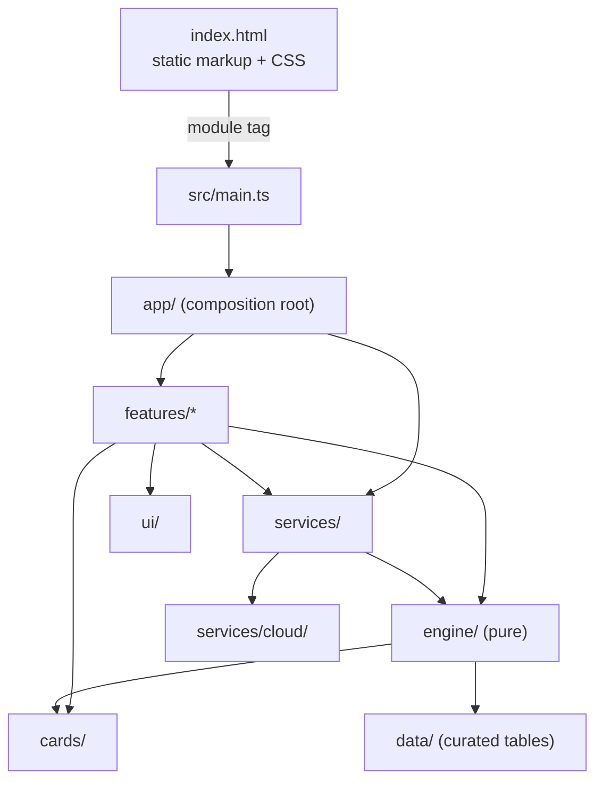

# Architecture (as built)

How PodMates is put together today, layer by layer. The target is the [refactor plan](refactor-plan.md) §4;
this page describes what exists. Contributor rules
are in [CLAUDE.md](../CLAUDE.md); domain terms in the [glossary](glossary.md).

## Big picture

PodMates is a static Vite site. `index.html` is a static shell: markup, the main CSS and two script tags,
`<script type="module" src="./src/main.ts">` and the colour-theme pre-paint placeholder, which the build
replaces with `src/features/themes/prepaint.ts` bundled to a classic script (it must run before first paint,
so it cannot be a deferred module). `tests/static-shell.test.ts` keeps it that way: no inline scripts and no
inline event handlers. Nothing is published on `window`.

`src/main.ts` runs after the document is parsed and before `DOMContentLoaded`. It imports the
**composition root**, `src/app/`, one module per feature, in a fixed order:

1. `app/page.ts` starts the card-database boot (`services/card-data.ts`) and its stall watchdog
   (`services/boot-status.ts`), and mounts the deck form and the mode tabs: the work the inline page script
   used to do while the document parsed, so its listeners stay first.
2. `app/input-limits.ts` and `app/card-clicks.ts`, the page-wide focus and click delegates.
3. One wiring module per feature (Deck Chart, Try-a-Deck, export, card viewer, scan, Deck Crafter, Impact,
   Spoiler Bait, comparison, trades, PriceScry, profile, auth, Gatherings, Chronicles, saved decks, MyPods),
   then the Japanese hint. Each supplies its feature's ports from services and other features' exports.

Then `main.ts` installs the global error handlers and the sticky-Close net and mounts notifications.

### Build

`vite.config.js`'s `page-html` plugin emits `index.html` with its artwork unchanged, the theme pre-paint
inlined and the CSP's script hashes computed. It builds one entry (`main`), substitutes `./src/main.ts` with the
hashed chunk, and emits the linked stylesheets as hashed assets. A missing `main` entry fails the build. See [deploy.md](deploy.md) for Pages deployment.

`vite-plugin-pwa` runs Workbox `generateSW` after the HTML is emitted. It reuses the manifest/icons and
precaches the shell and hashed chunks, excluding the DB worker. `src/services/pwa.ts` gates initial dataset
fetches on SW control (bounded to five seconds), then offers updates without forced reloads. Data runtime
caches survive code deployments: NetworkFirst for the manifest, StaleWhileRevalidate for full hash-query
dataset URLs, CacheFirst with expiry/size limits for Scryfall card art only. No cloud/Worker API is cached.
Offline DB boot uses the existing main-thread codec because its web worker is deliberately uncached.
Only previously requested lazy datasets are available offline. See [recovery and budget](deploy.md#emergency-kill-switch);
the current card payload alone exceeds the plan's 1.5 MB target, so the documented interim CI ratchet is
750 KB code / 3.5 MB including boot data, not a claim that §10 is met.

### Accessibility

`tests/e2e/accessibility.spec.ts` runs axe on the deck form, Try-a-Deck home/archetype list, chart
(with result disclosures expanded), info dialog, sign-up and log-in. Full axe results are attached to the
Playwright report. Serious/critical findings fail e2e, with one design-deferred exception below.
No authenticated pod view is covered by the offline suite; this is not a full-app accessibility audit.

The shared modal derives its accessible name from the current heading unless an explicit label was supplied.
Replacing legacy dialog content updates that name and restores focus inside if the focused control was removed.
Existing Escape, Tab trap, close and focus-return behavior remains covered. Auth inputs now have explicit
accessible names and autocomplete hints; toasts use a polite live region.

**Design-deferred:** teal `comboTag(..., 'warp')` badges have hardcoded `#06201f` text on `#3d8f8a`
(4.45:1 at 10px bold, required 4.5:1). These colours are not theme tokens; changing them would be a visual
design decision outside this pass. The test only waives `color-contrast` nodes marked
`data-contrast-review="combo-warp"` with that exact colour pair and ratio; all other rules on those nodes
still fail. The unfiltered findings remain in the report. Remove the marker and waiver once design approves
an accessible colour pairing. Other themes and signed-in pod flows need a later audit.

### Error reporting

`src/services/report-error.ts` owns the consistent redacted console line and the single future remote-reporter
extension point. Only a fixed operation, safe error category and severity reach the sink, never raw messages,
stacks, deck links, document paths or credentials. User-triggered failures also show a generic plain-text toast.
Reporting preserves rejection objects and the existing result shapes; an error crossing several boundaries is
deduplicated. `src/main.ts` installs `error` and `unhandledrejection` listeners once without suppressing browser
defaults. Background/best-effort cloud failures remain non-blocking but no longer disappear silently.
Optional offline-cache registration failures remain warnings so online use is unaffected.

`src/services/scryfall.ts` handles JSON/network/HTTP failures for card art (`src/services/card-art.ts`)
and Spoiler Bait, both through direct imports. Expected no-match 404s remain normal results for named/search lookups;
other failures report before the existing fallback UI runs. Card-DB worker errors report on the main thread
and still reject into the boot error UI.

Everything renders through lit templates, which escape interpolated text; there is no HTML sanitizer any
more (the DOMPurify bundle and its `sanitizeHtml` boundary left with the last inline script).
`scripts/rendering-lint.mjs` rejects every nonliteral HTML sink (`innerHTML`, `outerHTML`,
`insertAdjacentHTML`, …), bans `document.write`/`writeln`, and requires a reviewed `Trusted:` rationale
for every `trustedHtml` call. SVG, styles, IDs and data attributes remain supported;
executable attributes and unsafe URL schemes are removed. Former inline click handlers use delegated events.

The CSP meta defaults to no resources, then allows only the app's required origins and resource types.
`scripts/content-security-policy.mjs` computes the hash of the one inline script (the theme pre-paint, inlined
at build/serve time) after production URL substitution and Vite's development transforms; do not hardcode or
hand-update hashes. Inline styles remain allowed for legacy layout; inline executable handlers and arbitrary
scripts do not. Browser fixtures fail on CSP violations.

Invite URLs now show a sharing warning and require explicit consent before joining a pod. The public
deck-sync source is currently `deck-link-sync-worker.js`, not `workers/deck-sync/`: it accepts only GET/OPTIONS,
known app/development origins, and bounded HTTPS deck paths. Fixed upstream endpoints disallow redirects,
time out after ten seconds and cap streamed responses at 2 MiB. The owner confirmed on 2026-11-13 that the
deployed Worker matches this file. Deploying that Worker remains separate from the Pages deployment (by hand,
in Cloudflare); after changing the file, paste it into the Cloudflare editor or the two drift apart.

## Layers

| Folder                 | Owns                                                                                             | May import                                                                   |
| ---------------------- | ------------------------------------------------------------------------------------------------ | ---------------------------------------------------------------------------- |
| `src/engine/`          | Pure deck analysis and scoring ([rules](../src/engine/CLAUDE.md))                                | own files, `cards`, `data` (not the loader), `shared`                        |
| `src/cards/`           | Card tuples, DB worker/codec, lookup, decklist parser                                            | own files, `shared`, `data/load-dataset` (until p5-3)                        |
| `src/data/`            | Curated tables and the dataset loader                                                            | not `engine` or `features`                                                   |
| `src/services/cloud/`  | Firebase Auth/Firestore, one repository per area                                                 | the Firebase SDK (only here)                                                 |
| `src/ui/`              | Shared primitives: `html`, modal, toast, status, tooltip, tabs, radar, mana symbols, card names  | own files, `shared`                                                          |
| `src/styles/`          | `tokens.css` (custom properties) and `base.css`                                                  | —                                                                            |
| `src/services/`        | Shared state and behaviour: card data, boot status, deck form, current chart, events, …          | `ui`, `engine`, `cards`, `data` — never `features` or `app`                  |
| `src/features/<name>/` | One user-facing area each                                                                        | `ui`, `engine`, `cards`, `services`, `data` — never another feature or `app` |
| `src/app/`             | Composition root: one wiring module per feature, plus cross-feature battle/mode/active-pod state | anything                                                                     |
| `src/main.ts`          | Page boot entry                                                                                  | `app/` (in order), error handlers, notifications                             |

`src/shared/` holds code run by both the app and the pipelines (PriceScry name key/shard hash/consensus,
`planTrade`, mana production). It imports nothing from other `src/` folders, no Node built-ins and no browser
globals (lint). The pipelines import its `.ts` files by their real name and Node runs them with built-in type
stripping (Node 22.18+; the workflows' `node-version: 22` resolves to a newer 22.x), so no build step or `tsx`
install is needed and the files must stay erasable TypeScript. `pipelines/lib/shared-runtime.test.mjs` runs the
pipelines in a plain `node` child process to catch syntax Node cannot strip.

### Pipelines (`pipelines/`)

Node `.mjs` builders are grouped into `card-db/`, `winrates/`, `spellbook/`, `pricescry/` and
`reference-corpus/` (the staples and mana-base benchmark baselines, rebuilt from the engine).
Shared HTTP, gzip/file I/O, manifest, publication and assembly helpers live in `lib/`.
Their separate `tsconfig.json` enables JSDoc `checkJs` through `npm run typecheck`; Vitest
builder fixtures and the former PriceScry self-tests run in `npm run check`. Inputs,
outputs, schedules, named secrets and production-write cautions are in
[`pipelines/README.md`](../pipelines/README.md). Builders write data, never application source.
The knowledge, Impact-candidate, reference-score and fingerprint builders are still unrecovered and have not been fabricated.
All Scryfall bulk workflows use the shared composite action in
`.github/actions/scryfall-bulk/` and its streaming `pipelines/lib/scryfall-bulk.mjs`
helper. Current upstream revisions are cached without stale fallback; consumers
retain plain/gzip magic-byte handling. Weekly schedules stay separate from deployment:
Deploy Pages publishes only a commit on `main` whose CI passed, chosen by `scripts/resolve-deploy-commit.mjs`
(after CI, after each rebuild, Auto-merge or a manual rollback; see `docs/deploy.md`). `scripts/auto-merge.sh`
merges green session branches (`ccr-…`, `claude/…`), `scripts/ci-summary.mjs` writes each CI job's Summary page and
`scripts/ci-status.mjs` lets a session follow its branch without `gh`. One-off PriceScry workflow definitions are archived
by commit in the pipeline README; the manual Spellbook artifact builder remains.

### Engine (`src/engine`)

`analyzeDeck` and everything it calls are strictly typed modules; curated tables (`HARD_COMBOS`,
`SOFT_SYNERGIES`, `GAME_CHANGER_REASONS`, `DEFAULT_IMPACT_CARDS`) are in `src/data/*.ts`. Inputs come
through an explicit `EngineContext`. The page's context is `pageContext()` in `src/services/card-data.ts`,
memoised on the loaded card DB, Spellbook index and commander win-rates. `reference.ts` computes percentiles and tier
placement against the reference set (`REFERENCE_SCORES` / `REFERENCE_TIERS` plus the curated
`src/data/reference-spark.ts`), and `benchmarks.ts` the closest-precon match, staples check and mana-base
benchmark; `src/services/reference-data.ts` holds their datasets. ESLint keeps the engine pure: no page
globals, no module-level `let`.

### Cards (`src/cards`)

`tuple.ts` owns the published tuple layout: a `CardTuple` type, a named accessor per position and
`cardFromTuple`, which `db-codec.js` uses instead of indexing a tuple. `lookup.ts` holds name normalisation,
`buildLookupIndexes`, `levenshtein`, `fuzzyFindCard`, `getCard` and `matchDecklist`; `parse-decklist.ts`
holds the decklist parser.

`load-db.ts` starts `db.worker.ts`: the worker fetches the manifest-versioned `cards.json` URL resolved on
the main thread (unchanged gzip/base64 string), decodes it and builds name indexes with the shared, type-checked
`db-codec.js`. Plain card objects and index-entry arrays are cloned once; main-thread `Map` hydration
preserves card identity. Without Worker / worker-side decompression support the same codec runs
on the main thread; without a main-thread `DecompressionStream` the existing unsupported-browser error shows.
Real fetch/decode/index progress advances the bar and resets a 30-second stall deadline; there is no total-load
timeout. Worker errors and stalls terminate the worker and use the boot error UI.
`load-db.ts` alone may import `services/report-error` to report that failure boundary; the worker, codec
and engine-facing card modules keep their existing service-free import restrictions.

`src/services/card-db-boot.ts` owns required dataset loading, freshness, DB orchestration and the optional
Spellbook gzip/base64 decode/index with its 15-second deadline. `src/services/card-data.ts` calls it once
(`bootCardData`) and owns the results: the card DB and lookup indexes, Spellbook index, win-rates, Tagger tag
sets, the lazy deck library and card knowledge, the ranked card search and `pageContext()`. Features receive
them through ports from `src/app/`. `src/services/boot-status.ts` owns the loading bar (`#dbStatus`,
`#dbLoadFill`): progress, the 30-second stall watchdog and the ready/error states, rendered with lit. Required
failures reject through the redacted error sink into the unchanged boot error UI; optional snapshot failures keep the
curated-combo fallback and its status/diagnostic message. Worker/fallback identity, progress and stall
handling stay in `cards/load-db.ts`.

### Data (`src/data`, `public/data`)

`public/data/<CONSTANT>.json` holds `SPELLBOOK_SNAPSHOT_B64`, `KNOW_JSON`, `IMPACT_CANDS`,
`REFERENCE_SCORES`, `REFERENCE_TIERS`, `PRECON_FINGERPRINTS`, `STAPLES_BASELINE`, `MANABASE_BASELINE`
and `TRY_A_DECK_OPTIONS` (178 decklists). Spellbook keeps its exact gzip/base64 encoding inside a JSON
string; the other files contain their original runtime values. `scripts/extract-static-datasets.mjs` reproduces
these files from pre-extraction HTML.

`src/data/load-dataset.ts` revalidates `data/manifest.json` first, then fetches relative to Vite's `BASE_URL`
with `?v=<sha256>`, caching promises and reporting each fetch's start and finish to `onDatasetProgress`, which
the boot bar subscribes to. Each manifest entry has `version` (content hash prefix), ISO `generatedAt`, `sha256`, `bytes` and
`source`. The footer shows card/win-rate dates and quietly warns (text + console) when cards are over 14 days
old. Extraction scripts and refresh pipelines write metadata; deployment merges bot entries with static entries
without resetting sibling dates.

- **Eager** (`services/card-db-boot.ts`): reference scores/tiers, staples/manabase baselines, tags and win-rates,
  because every complete analysis uses them; cards and Spellbook (Spellbook keeps its optional fallback). Required
  boot failures use the boot error UI. The reference datasets go to `services/reference-data.ts`;
  `tags.json` / `winrates.json` fill the tag sets and win-rates in `services/card-data.ts` before DB-ready.
- **Lazy:** `loadDeckLibrary()` loads/filter-checks Try-a-Deck lists for the library, sample table and card-search
  rankings. First chart/pod-detail requests use `loadAnalysisDatasets()` (`services/reference-data.ts`) for
  fingerprints plus derived `TRY_A_DECK_METADATA` (validation lists kept only for announced decks). `loadKnowledge()` builds
  the knowledge map when "Cards you could add" opens; Impact loads its candidates when its modal opens. Loading UI stays
  visible while waiting; dismissed overlays cannot reappear; card searches discard superseded queries.

Weekly workflows publish validated `cards.json`, `tags.json` and `winrates.json` on the `data` branch;
deploy copies them into `dist/data/` and records exact revision/hashes in `build-manifest.json`.
Branch-dispatched rebuilds use `data-<source-branch>`. Publish/assemble helpers in `pipelines/lib/` validate
shapes/counts and SHA-256 manifests; publication is lease-protected and serialized. Legacy hash-only publications
use their stable Git publication time until refreshed, never deploy time. `scripts/extract-bot-datasets.mjs`
reproduces the fallback snapshots and pins win-rates for golden tests. `node scripts/generate-data-manifest.mjs`
reproduces derived metadata; byte-identical entries keep their dates. Never use it to hide a stale-data warning.

### Cloud (`src/services/cloud`)

One typed repository per Firestore area (decks, linked decks, users, profile, pods, members, gatherings,
table formations, chronicles, trades, impact, spoiler votes, activity) mirroring the existing paths and field names exactly. Only `firebase.ts` imports the SDK
(bundled from npm). Callers import the repositories directly; `operations.ts` wraps user-triggered and
background calls with the redacted error reporting. `limits.ts` holds `PM_LIMITS` (used by the input limits in
`src/app/input-limits.ts`, the friendly decklist check and the repositories). Tests mock `./firebase` with `testing/fake-firebase.ts`.
The unchanged rules file is `firebase/firestore.rules`. `firebase/firebase.json` is emulator-only;
the indexes file matches the console (no composite indexes; `tests/firestore-indexes.test.ts` keeps queries single-field). Sessions never deploy rules.
`npm run test:rules` (Java 21+) runs a separate CI job against `demo-podmates-rules`.
See [rule-branch coverage and known security gaps](../firebase/coverage.md); expected-failure
tests record unresolved policy/limit gaps rather than changing the deployed behavior.

### UI primitives (`src/ui`) and global styles (`src/styles`)

Modules import the primitives directly (`modal.ts`, `tabs.ts`, `toast.ts`, `status.ts`, `tooltip.ts`).
`confirm.ts` holds the Delete and action confirms,
`sticky-close.ts` the pinned-Close safety net that `main.ts` installs, and `decks-table.ts`/`.css` the
sortable saved-decks table shared by Build Table and My Profile. The page-wide tooltip wiring waits for
`DOMContentLoaded`. `html.ts` re-exports lit-html; its `trustedHtml()` is the only raw-markup path, and ESLint
forbids importing lit-html anywhere else. `tokens.css` and `base.css` are linked before the first
`<style>`, so the cascade is unchanged.

`mana-symbol.ts` owns `MANA_COLOR_STYLE` and the W/U/B/R/G/C pip artwork (`manaSymbolHtml` for legacy
string builders, `manaSymbol` for lit callers); `card-name.ts` owns the clickable card name. The lit variants
return raw markup on purpose: a list of names joined by `", "` must stay one text node, or Chrome's sub-pixel
text layout shifts by a hundredth of a pixel.

Overlays open through `modal.ts`, which owns Escape, the Tab trap, focus restore, body scroll lock and
stacking; looks come from the overlay's own classes. `src/ui/tad-modal.ts`'s `openTadOverlay(opts)` wraps it for every
`.tad-overlay`/`.tad-modal` dialog: a base layer (`#tadOverlay`) replaces the open one, `{ stacked: true, id }`
layers on top, and `onDismiss` keeps the backdrop/Escape behaviour. Close with `closeTryADeckModal()` or
`closeModal(el)`, not `el.remove()`. Set dialog width through `modalStyle`; assigning `style.cssText`
afterwards drops `outline:none`.

### Features (`src/features`)

A feature owns one user-facing area: `state.ts` (pure rules), `view.ts` / `panels/*.ts` (lit templates), a
CSS file with a feature-scoped class prefix and tests. Its wiring lives in `src/app/<name>.ts`, which supplies
the feature's ports; features never import each other or `src/app`.
Feature CSS is a `<link>` in `index.html` plus an entry in `vite.config.js`'s stylesheet loop. Port legacy
string templates with each rendered text run as a **single interpolation**: `` html`${pct}%` `` makes two text
nodes, which Chrome lays out differently from the original one-string markup.

Moved so far: `deck-chart` (prefix `dc-`) — Structure & Legality, Mana Curve, Mana Base and Card Type
Frequency & Curve, plus `deck-chart/interactions/` (prefix `ix-`): the Synergy panel's interaction reading
(trigger/rule packages, deck and theme plans, Super Friends, the stat-axis rule, conditional and idle cards),
its package markup and the "Cards you could add" sheet (repeaters/multipliers, plan helpers, thin spots,
best-of themes and New dimension). The reading is display only and receives the card DB, Scryfall Tagger tags
and `KNOW_JSON` knowledge explicitly through its ports (`src/app/deck-chart.ts`). `deck-chart/report.ts` (`report.css`, prefixes `kp-`,
`syn-`, `tr-`, `cc-`, `ex-`) renders Key Pieces & Combos (`key-pieces/`), Synergy and Commander Track Record
(`synergy/`), Commander Centrality (`centrality/`) and every "How was this built?" dialog (`explainers/`).
Package text from `ixDescribePackage` is still app-built string markup (card text escaped, names linked); the
Synergy panel inserts it with a commented `trustedHtml`. The explainers own the delegated
`[data-go-key-pieces]`, `[data-explain]` and `[data-gc-card]` clicks; the page-wide card/type delegate
(`src/app/card-clicks.ts`, registered first) skips them so the old precedence holds. `deck-chart/index.ts` binds Chart Deck; `run-analysis.ts` reads the form, analyses the list
and paints every panel, and `results/` (`results.css`, prefix `rs-`, scoped to each panel's id) renders Win
Condition, Closest Match, Table Vibe, the radar area, Bracket, the not-found box and the legality dialog. The
deck being charted lives in `src/services/current-chart.ts` for Impact, export, the type galleries and the
explainers; the commander portraits and Impact caption follow the typed `chart:commanders` / `chart:radar`
events. The shared read-only dialog is `src/ui/info-modal.ts`; `try-a-deck` (`tad-`) — all library browsing/navigation; `export` (`export-`) —
Commander/Deck text and clipboard dialog; `scan-cards` (`scan-`) — local Tesseract loading, bounded
preprocessing, longest-name-first matching, selection and rescan lifecycle; and `deck-crafter` (`db-`
inside `.deck-crafter`) — drafts, commander/partner selection, identity filtering, card search, quantities,
removal and save/chart handoff; and `card-viewer` (`cv-`) — View Deck, Card Type Frequency galleries,
single-card art and the commander portraits, over the in-memory Scryfall art cache in `src/services/card-art.ts`.

The shared overlay and its former injected styles live in `src/ui/tad-modal.ts` / `tad-modal.css`. Feature
`mount()` APIs take explicit callbacks; `src/app/` binds them to the deck form (`services/deck-form.ts`), the
lazy deck-library gate and card data (`services/card-data.ts`) and the current analysis.
`src/services/deck-editing.ts` connects scan and Deck Crafter through explicitly registered typed callbacks.
No feature imports another feature or talks directly to Firebase.

The deck form's own controls (Clear, Deck Name auto-naming, the Archidekt/Moxfield link import) are
`src/features/deck-form`; its shared state (whether Deck Name was typed by hand, the last imported link) is
`src/services/deck-form.ts`, which Try-a-Deck, profiles, Deck Crafter and Saved Decks use through their ports.

Scanner files persist across dialog sessions, results reset on open, and obsolete asynchronous runs cannot
write into a replacement dialog. OCR failures remain visible even when another photo succeeds (the legacy
loop overwrote failures with “Done”). The shared error sink reports library/export/scan failures; preprocessing
fallbacks are warnings and still pass the original or scaled image to OCR. All successful-flow copy, limits,
colour filtering, full double-faced names and deck-form loading remain unchanged.

Deck Crafter's pure state is
independent of the DOM; lit templates preserve the existing markup and scoped CSS preserves the inline
dimensions. The localStorage key `podmates-deck-builder-draft` and its `cards`, `commander`, `player` fields
are unchanged. Storage failures report redacted warnings but do not prevent editing.

`src/app/deck-crafter.ts` supplies the page's card DB, ranked search (`src/cards/search.ts`), Save
(`decks:save`), the mode switch and `runChart()`. Deck Crafter keeps its own typed picker
(scoped `.deck-crafter .pm-sr*` styles); PriceScry and trades use the shared `src/ui/card-search.ts`
picker with the same ranking, touch selection, debounce and input scroll anchoring. It makes no
Firebase calls itself. `tests/e2e/deck-crafter.spec.ts` covers partner selection, quantity edits, persisted
draft restoration, draft/current-deck choices, signed-out save handoff and chart handoff.
Also moved: `auth` (prefix `auth-`) — sign-up/log-in, provider and password-reset flows, the
account bar and save guard; `profile` (prefix `profile-`, `pp-`) — My Profile/onboarding, saved/linked deck
merging and mirror repair, display-name/profile-link edits, sign-in details, quick deck summaries, and
public player/pod profiles with the unchanged aggregate analytics.

Auth, profile and pods communicate through the typed `src/services/events.ts` bus,
never through feature imports. Both mount from `src/app/`. Cloud operations
import repositories directly; failures retain their status/toast behavior and report through the
redacted sink. Browser-only last-sign-in hints remain optional and never reach that sink.

The profile runtime ports adapt the deck chart, comparison table, themes, backup and
PriceScry entry points.

Also moved: `themes` (prefix `pm-theme-`, `pm-size-`, `pm-display-`) — the 27 colour themes, the text-size
setting and the Display settings tray in My Profile. `palette.ts` holds the theme list and pure colour maths
(`buildTheme`, `auditThemes`; the unit test requires the audit to stay empty and snapshots every theme's values).
`apply.ts` writes the CSS variables, `data-pm-theme` / `data-pm-text`, `zoom`/`--pm-zoom` and the `theme-color`
meta, and saves to `localStorage` (`podmates-theme`, `pm-text-scale`); the root attributes are the single record of
what is applied. Because module scripts are deferred, `prepaint.ts` cannot be a module: `index.html` keeps
`<script id="theme-script" src="./src/features/themes/prepaint.ts">`, and `scripts/theme-prepaint.mjs` bundles that
file to a classic IIFE and inlines it (Vite `transformIndexHtml` in dev, `generateBundle` in the build) before the
CSP hashes are computed. The radar reads `data-pm-text`; `src/app/profile.ts` passes the themes `mount` to My
Profile as its Display settings port. The shared modal is imported from `src/ui/tad-modal.ts`. Pods uses
typed auth/public-profile navigation events; the save guard reaches Chronicles, profiles and Saved Decks
through their ports. The account screens keep their DOM/classes and token colours; the
signup, login and My Profile screenshots are byte-identical to the pre-extraction views.

Also moved: `pods` (prefix `pods-`) — MyPods landing/create/join, active-pod selection,
URL-invite consent, membership, steward settings and live Gathering invitations.
`state.ts` owns pure selection, invite and permission helpers; `index.ts` owns the mount lifecycle.
`detail.ts`, `members.ts` and `live-invites.ts` split settings, member actions and subscription cleanup.
Cloud calls import repositories directly; no Firestore paths, fields or stored roles changed.
`view.ts` uses escaped lit templates, and `pods.css` replaces the inventoried inline styles.

`src/app/pods.ts` supplies the shared modal and confirms, refreshes Chronicles on `pods:active`, re-renders on
`pods:refresh` and provides the active pod (`src/app/active-pod.ts`) to Chronicles, profiles and PriceScry.
Typed navigation events connect Gatherings and Spoiler Bait without feature-to-feature imports. Repeated renders dispose old subscriptions; unmount also invalidates pending
loads and removes the active overlay. Pending URL invitations require explicit consent after sign-in,
and declined invitations cannot be retried by later auth events.

Also moved: `gatherings` (prefix `g-`) — hosting and saved lineups, guests, invite delivery
confirmation, RSVP and landing cards, waiting/live seats, end warnings and sample tables.
`state.ts` owns pure seating, stale-invite and reply rules. `host.ts`, `waiting.ts` and `view.ts`
split the dialogs; `tray.ts` shares seat controls; `watch.ts` owns one listener with an
eight-second polling fallback. Closing or replacing a tray stops its listener/timer, and
obsolete loads cannot paint a newer tray. Live updates never overwrite an end confirmation.
No Firestore paths or fields changed, and missing legacy RSVP fields still mean accepted.

Pods emits typed `gatherings:host`, `gatherings:sample` and `gatherings:paint` events; gatherings
requests a pod refresh through `pods:refresh`. Neither imports the other feature.
`src/app/gatherings.ts` supplies the library/analysis gate, comparison results, battle context/controls
and the saved-deck picker. Battle logging, feedback and results polling are owned by Chronicles; the current
battle and its decks live in `src/app/battle.ts`, shared with Chronicles, comparison and the mode switch.
Repository-mocked interaction tests cover authenticated host/RSVP/chart/end flows;
`gatherings.modules.spec.ts` covers sample loading/cancellation and the six-deck handoff without
authentication.

`chronicles` (prefix `chronicles-`) owns the shared pod journal, newest-first Gathering-title grouping,
historical entries, participant/leader edit visibility, notes, deletion, leader-only clearing and optional
post-battle ratings/highlights. It uses cloud repositories directly and preserves document paths/fields.
Modal confirmation, account guards, comparison analysis and the current battle are runtime ports, not
cross-feature imports. Chronicle snapshots, Log/Repeat/New Battle and End Gathering result controls
use the Gathering repository directly. The result watcher ignores pending writes and previous-battle IDs,
disposes subscriptions/timers and rejects stale completions; the eight-second read fallback is unchanged.
Concurrent journal reads are scoped to the current account/pod so stale
responses cannot overwrite a newer selection; read failures retain the empty-list fallback and report to
the redacted error sink. Unit tests cover scope/permissions, notes and feedback writes and failures; the
offline browser suite covers guest journal access/sign-in handoff, and `chronicles.modules.spec.ts` Log Battle
confirmation and host-only post-battle controls. Repository-mocked tests also cover independent ratings/skip, guest-safe repeat,
new/end writes and realtime/fallback teardown.

`impact` (prefix `impact-`) owns the default/proposed list, reasons, candidate queue, nominations,
search, reset and the separate Pod view below the radar. Its state helpers compute proposed Power/Spark
without mutating the standard analysis. Cloud calls import the Impact/pod/session repositories directly;
the `pm_impact_pod` preference and all Firestore paths/fields are unchanged. Candidate data stays lazy,
and dismissed loading dialogs cannot reappear. Repository loads are account-scoped and ignore superseded
pod requests. Expected nomination-permission failures keep the existing read-only fallback and report
through the redacted error sink.

Impact has no globals: it mounts its radar caption on the typed `chart:radar` event.
`src/app/impact.ts` supplies the current analysis (`services/current-chart.ts`), library gate and ranked search;
scroll anchoring comes from `ui/card-search`; no feature imports another feature. Tests cover Steward/Co-Steward edits, member nominations,
reason escaping, undo/reset, stale loads and score isolation; Chromium covers the chart entry point,
lazy loading, ideas, focus return and dismissal during loading.

`spoiler-bait` (prefix `sb-`) owns the shared ten-day swipe queue, rarity filters, optimistic
Bang/Bin votes, undo, Bangers/Binned lists and pod-board aggregation. `state.ts` is pure;
`data.ts` retains the three-page Scryfall search, thirty-minute cache and optional 75-card rarity
enrichment. Device key `pm-sb-rarities`, vote keys, Firestore paths and fields are unchanged.
Cloud access imports the existing session/spoiler-vote repositories directly.

The feature subscribes to typed `spoilers:open` and `pods:active` events. PriceScry's Bait tab mounts it
(`src/app/pricescry.ts`) with the recorded signals, day, pod and card-navigation callback explicitly.
Lit templates preserve the old DOM/classes and styles use tokens with the original colours.
Replacing/dismissing a host retires pending renders, animation timers and global pointer listeners.
Tests cover authenticated votes/undo/move/unsort, source selection, filters, board ordering,
account boundaries and teardown; offline Chromium covers the PriceScry sign-in gate.

`trades` owns purchase/edit, local price checks, sale entry/edit/preview/removal, trade deletion and
CSV export. Templates retain the existing dialog controls and PriceScry classes; form-only layout
is in `trades.css`. The pure state helpers retain yen rounding, the sold-quantity floor, Mercari
fees/shipping, cost basis and partial/closed-position accounting. Repository writes import
`services/cloud/trades` directly without changing `users/{uid}/trades` fields or paths.

`src/app/trades.ts` supplies PriceScry price/name lookup, Ledger refresh and the shared ranked
picker (`ui/card-search` over the page card DB). Ledger requests trade actions through typed `trades:*` events, never another feature's
imports or globals. `services/trade-ledger.ts` owns the shared accounting and current lot/mark
snapshot (and `toInt`/`TradeDraft`); `trades/state.ts` re-exports its existing API for the dialogs.
Price/name lookup comes from `services/price-data.ts`, and PriceScry opens purchases through the
`trades:purchase` event. Async lookup/save
completions cannot alter or dismiss a replacement dialog, and write errors report through the
redacted sink while preserving the original form/toast messages. Repository-mocked tests cover
purchase/edit, sale/edit/removal, mark removal, deletion, failure/retry and stale completions.
`trades.modules.spec.ts` covers dialog validation, preview and cancellation without authenticated writes;
the purchase, sale and price-check screenshots are byte-identical to their pre-extraction views.

`notifications` (prefix `pm-notif-`) owns the in-app bell, merged pod activity feeds, unread cutoff,
thirty-day filter, per-type preferences and pod muting. Existing `pm_notif_seen_<uid>` and
`pm_notif_prefs_<uid>` device keys, activity text/colours and Firestore paths/fields are unchanged.
First use starts the unread cutoff at the current time; opening marks seen without removing fresh-row
highlights. Lit templates escape names and subjects; styles replace the inventoried inline declarations.
Auth changes clear old-account state immediately, and generation guards ignore obsolete pod loads/feed
callbacks. Membership writes emit `pods:membership` after success, so direct repository callers refresh
subscriptions too. Navigation uses `gatherings:open` and `pods:open`
events, not cross-feature imports. Storage and feed failures report through the redacted sink while remaining non-blocking.
Repository-mocked tests cover authenticated badges, seen state, settings, routing, account isolation and
teardown; offline Chromium covers the real dialog/settings/Escape lifecycle without cloud writes.

`ledger` owns the PriceScry Ledger tab: All/Real/Paper filters, realised and unrealised totals,
closed-trade expectancy/reason summaries, open/closed positions and sale/action buttons.
It reads `cloud/session` and `cloud/trades` directly, and prices open lots through `services/price-data.ts`.
PriceScry's Ledger tab mounts it through `src/app/pricescry.ts`.
An owned display-contents root prevents a delayed repository/price response from replacing another tab.
Generation/account checks also prevent publishing stale lots or marks into the shared snapshot.
Tests cover partial-sale accounting, missing prices, filter/export/edit wiring, escaping, signed-out
and repository-error states, account changes and tab replacement.

`comparison` mounts the battle-result shell and owns Rule Zero, alignment, mismatches and optional
nudges, seat rankings, axis tables, pace/interaction risks, mini radars and lazy deck-detail dialogs.
`services/deck-analysis.ts` holds the unchanged decklist-to-analysis pipeline shared with profiles
and saved-deck tables; it takes engine context, lookup indexes and commander detection explicitly.
`src/app/comparison.ts` mounts it and registers it as the battle results view (`src/app/battle.ts`), which
sorts the decks and refreshes the journal; it also supplies the lazy analysis datasets. Templates auto-escape text;
fixed tier colours are tokens and only dynamic seat colours remain inline styles. SVG templates
retain the original geometry, including the mini radar's containing-block height, without the
invalid legacy `height="auto"` attribute. Dismissed/replaced details ignore late dataset completions.
`comparison.modules.spec.ts` exercises the real six-deck sample renderer, all panels, deck detail and mode
restoration; Ledger's real tab/sign-in/reopen flow runs without authenticated RPCs. Authenticated
Ledger behavior is repository-mocked in unit tests, not a live-account browser test.

`pricescry` owns the full-screen price tool: the soft password gate, Search and the card page (printing/
finish pickers, SVG chart and readout, current prices, trade planner, facts), Movers, Signals (spoiler
strip, prediction scoreboard, cheap-pick watch) and Radar. Only `index.ts`, `runtime.ts` and the CSS load with
the page; `access.ts`, `screen.ts` and the views are one `pricescry-screen` chunk, loaded on first open through
`import("./pricescry-screen")`. A code update re-downloads it with main, whose shared chunk it imports.
`services/price-data.ts` owns the published-data fetch/cache, change-point series, yen conversion, consensus
price and `currentYen`, shared with Trades and Ledger; the name key, shard hash, consensus rules and `planTrade`
come from `src/shared/`, the same code the pipelines run. Profile opens
the screen with `pricescry:open`, Trades returns to the Ledger tab with `pricescry:tab`, and `src/app/pricescry.ts`
supplies the Ledger/Spoiler Bait mounts, the shared card picker and card-DB badges through ports. Views
replace `#psBody` wholesale like the inline screen did (the Ledger and Spoiler Bait ports replace its children
too), and cached tabs re-render synchronously so the modal focus trap cannot run during "Loading…" and
reset the scroll. `pricescry.css` loads before the main stylesheet, so the tab/range buttons restate their
background/cursor for `:hover`/`:disabled`. A temporary harness compared the normalized DOM, computed styles and
boxes of 22 views (desktop and 390 px) against the inline build: only intended attribute changes and
transition-timing noise differ. Unit tests cover the helpers, planner, chart/signal logic and lazy
lifecycle; offline Chromium covers the gate, search → card → back and every data tab with fixture data.

## Lint-enforced boundaries

`eslint.config.js` makes every rule an error (no warn-only rules remain):

- Layer imports as in the table above: features never import each other or `src/app`; services never
  import features or `src/app`; Firebase only in `services/cloud` and the isolated `firebase/` rules-test
  tooling; lit-html only through `src/ui/html.ts`; `no-unsanitized` everywhere, with no sanitizer exception.
- **No globals:** in `src/`, assigning to `window`/`globalThis`/`self` or `Object.assign(window, …)` is an
  error everywhere (event-handler properties such as `self.onmessage` are fine). There are no exceptions.
- **`max-lines` 500** (blank lines and comments excluded) for `src/` and `tests/`; curated `src/data` tables are
  exempt. Aim for about 400.
- Pipelines (`pipelines/`) and the deck-sync Worker use the recommended rules
  as errors, allowing unused parameters, ignored catch bindings and `cond ? a++ : b++`.

`index.html` has no inline scripts to lint; `tests/static-shell.test.ts` fails if one (or an inline event
handler) comes back. TypeScript is strict; `allowJs` stays on (with `checkJs: false`) because `db-codec.js`,
the pipelines and the Worker are still JavaScript.

## Tests

- **Golden** (`tests/golden`): `harness.ts` imports `src/engine` directly and builds an `EngineContext` from pinned
  card, Spellbook and win-rate fixtures (7,621 cards, 3,397 Spellbook rows including one-card-away candidates;
  `fixtures/winrates.json`, never the weekly publication). It analyses all 178 Try-a-Deck samples and snapshots
  the full analysis plus all five axes; JSON keys are sorted recursively, array order and floats preserved.
  `harness.test.ts` re-runs every sample with deep-frozen inputs in reverse order and requires identical results.
  No app start-up, DOM or network runs. Regenerate fixtures only deliberately; weekly data refreshes must not move
  this baseline.
- **Unit** (Vitest): next to the code as `*.test.ts`.
- **e2e** (`tests/e2e`, Playwright, Chromium): the smoke test waits for the real DB-ready message, charts a
  Try-a-Deck sample, checks the radar and the moved Deck Chart panels, then analyses a pasted list. The bundled
  Firebase SDK runs signed out; `offline.ts` fulfils Scryfall and Google Fonts locally and
  fails any other external request. Console errors and page errors always fail. Other specs cover the modal system,
  lazy data and the DB worker. The opt-in `db-boot.perf.spec.ts` (`PM_BOOT_BENCHMARK=1`, `--workers=1`) reports
  mobile boot blocking time under Pixel 5 emulation, 6x CPU slowdown, 150 ms latency and 200,000 bytes/s.
  `r1-features.spec.ts` covers release/style/archetype navigation, clipboard export and mocked client-side OCR
  through the real file input, checkboxes, rescan and Deck Crafter handoff. Set `PM_R1_SCREENSHOTS` to an
  artifact directory to capture the six main dialog views without committing screenshot baselines.
  Flows with no signed-out UI entry (the sample Gathering, battle controls, trade dialogs, the loaded
  win-rates and tags) are `*.modules.spec.ts` files in a second Playwright project that runs on the Vite dev
  server: there `withModules()` (`tests/e2e/modules.ts`) imports the page's own source modules by path,
  which are the same instances the page uses, so tests need no globals.

## What is not done yet

R14 (p3-6) finished: every strangler shim and inline script is gone, `index.html` is static markup, nothing
is published on `window`, and lint has no shim exceptions. Phase 3's exit criteria hold: no hand-written source
file over ~500 lines, no globals, all Firestore access through `services/cloud`, and no `innerHTML` with
interpolated data (`grep -rn innerHTML src` finds only comments).

Still open, outside p3-6:

- Some `src/app/` ports cast between structurally different feature types (Try-a-Deck and Gathering library
  rows, comparison and Gathering decks) where the old untyped globals hid the difference; a shared typed model
  would remove the casts.
- Plan §10's boot-size target is unmet; see [deploy.md](deploy.md).
