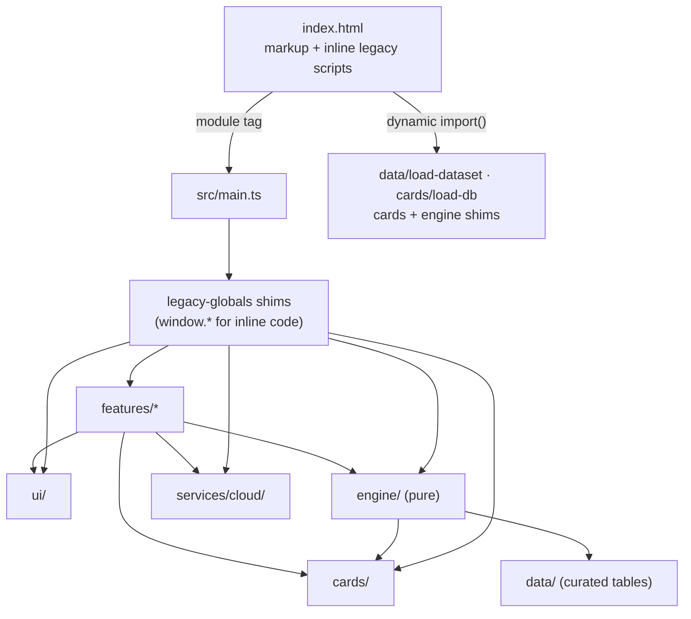

# Architecture (as built)

How PodMates is put together today, layer by layer. The target is the [refactor plan](refactor-plan.md) §4;
this page describes what exists, including the parts still inside `index.html`. Contributor rules
are in [CLAUDE.md](../CLAUDE.md); domain terms in the [glossary](glossary.md).

## Big picture

PodMates is a static Vite site. `index.html` is still about 13,100 lines: static markup, the main
CSS and the inline legacy scripts (theme, card-DB start-up, the app script with every unmoved feature, the
notifications inbox). Typed code lives in `src/`, and the inline scripts reach it in two ways:

1. **`src/main.ts`**, the one `<script type="module">` in `<head>`. Like every module it runs after the
   document is parsed and before `DOMContentLoaded`. Its imports evaluate in a fixed order: UI
   primitives, Deck Chart panels, engine, size limits, cloud.
2. **Dynamic `import()`** from the inline start-up code (`initDatabase` and the dataset gates) for
   `src/data/load-dataset.ts`, `src/cards/load-db.ts` and the card/engine shims.

Typed modules republish themselves for the inline code through **strangler shims** (`legacy-globals.ts`,
`src/services/cloud/index.ts`, `limits-global.ts`). A shim only re-exports; it is deleted with its
last inline caller. ESLint rejects any other `window` write in `src/` (see "Lint-enforced boundaries").

### Build

`vite.config.js`'s `preserve-legacy-html` plugin keeps `index.html`'s inline scripts and artwork unchanged.
It builds six entries (`main`, `datasets`, `cardDb`, `cardsLegacy`, `engineLegacy`, `scryfall`), substitutes each
`./src/…` URL in the HTML with its hashed chunk, and emits the linked stylesheets as hashed assets. Rollup
keeps one module instance across chunks, so a shim imported both by `main.ts` and by an inline `import()` runs
once. A missing loader entry fails the build. See [deploy.md](deploy.md) for Pages deployment.

`vite-plugin-pwa` runs Workbox `generateSW` after the HTML is emitted. It reuses the manifest/icons and
precaches the shell and hashed chunks, excluding the DB worker. `src/services/pwa.ts` gates initial dataset
fetches on SW control (bounded to five seconds), then offers updates without forced reloads. Data runtime
caches survive code deployments: NetworkFirst for the manifest, StaleWhileRevalidate for full hash-query
dataset URLs, CacheFirst with expiry/size limits for Scryfall card art only. No cloud/Worker API is cached.
Offline DB boot uses the existing main-thread codec because its web worker is deliberately uncached.
Only previously requested lazy datasets are available offline. See [recovery and budget](deploy.md#emergency-kill-switch);
the current card payload alone exceeds the plan's 1.5 MB target, so the documented interim CI ratchet is
750 KB code / 3.5 MB including boot data, not a claim that §10 is met.

### Accessibility

`tests/e2e/accessibility.spec.ts` runs axe on the deck form, Try-a-Deck home/archetype list, chart
(with result disclosures expanded), info dialog, sign-up and log-in. Full axe results are attached to the
Playwright report. Serious/critical findings fail e2e, with one design-deferred exception below.
No authenticated pod view is covered by the offline suite; this is not a full-app accessibility audit.

The shared modal derives its accessible name from the current heading unless an explicit label was supplied.
Replacing legacy dialog content updates that name and restores focus inside if the focused control was removed.
Existing Escape, Tab trap, close and focus-return behavior remains covered. Auth inputs now have explicit
accessible names and autocomplete hints; toasts use a polite live region.

**Design-deferred:** teal `comboTag(..., 'warp')` badges have hardcoded `#06201f` text on `#3d8f8a`
(4.45:1 at 10px bold, required 4.5:1). These colours are not theme tokens; changing them would be a visual
design decision outside this pass. The test only waives `color-contrast` nodes marked
`data-contrast-review="combo-warp"` with that exact colour pair and ratio; all other rules on those nodes
still fail. The unfiltered findings remain in the report. Remove the marker and waiver once design approves
an accessible colour pairing. Other themes and signed-in pod flows need a later audit.

### Error reporting

`src/services/report-error.ts` owns the consistent redacted console line and the single future remote-reporter
extension point. Only a fixed operation, safe error category and severity reach the sink, never raw messages,
stacks, deck links, document paths or credentials. User-triggered failures also show a generic plain-text toast.
Reporting preserves rejection objects and the existing result shapes; an error crossing several boundaries is
deduplicated. `src/main.ts` installs `error` and `unhandledrejection` listeners once without suppressing browser
defaults. Background/best-effort cloud failures remain non-blocking but no longer disappear silently.
Optional offline-cache registration failures remain warnings so online use is unaffected.

`src/services/scryfall.ts` handles JSON/network/HTTP failures for the inline art and spoiler requests via
a build-substituted dynamic import. Expected no-match 404s remain normal results for named/search lookups;
other failures report before the existing fallback UI runs. Card-DB worker errors report on the main thread
and still reject into the boot error UI.

The build also emits the locked DOMPurify browser bundle as a same-origin asset. It loads synchronously
before the legacy inline scripts, because some render during parsing, before module initialization.
The small `sanitizeHtml` boundary is the deliberate legacy-global exception; new features use lit templates.
`scripts/rendering-lint.mjs` checks every inline script with original HTML line numbers and shared scope.
Nonliteral HTML sinks require sanitization, `document.write`/`writeln` are banned, and every `trustedHtml`
call requires a reviewed `Trusted:` rationale. SVG, styles, IDs and data attributes remain supported;
executable attributes and unsafe URL schemes are removed. Former inline click handlers use delegated events.

The CSP meta defaults to no resources, then allows only the app's required origins and resource types.
`scripts/content-security-policy.mjs` computes inline-script hashes after production URL substitution
(and after Vite's development transforms); do not hardcode or hand-update hashes. Inline styles remain
allowed for legacy layout; inline executable handlers and arbitrary scripts do not. Browser fixtures fail
on CSP violations. The adversarial sanitizer case deliberately removes CSP to verify the sanitizer
independently, since Chromium can report event-attribute compilation in the sanitizer's inert document.

Invite URLs now show a sharing warning and require explicit consent before joining a pod. The public
deck-sync source is currently `deck-link-sync-worker.js`, not `workers/deck-sync/`: it accepts only GET/OPTIONS,
known app/development origins, and bounded HTTPS deck paths. Fixed upstream endpoints disallow redirects,
time out after ten seconds and cap streamed responses at 2 MiB. Deploying that Worker remains separate
from the Pages deployment.

## Layers

| Folder                 | Owns                                                                                            | May import                                                          |
| ---------------------- | ----------------------------------------------------------------------------------------------- | ------------------------------------------------------------------- |
| `src/engine/`          | Pure deck analysis and scoring ([rules](../src/engine/CLAUDE.md))                               | own files, `cards`, `data` (not the loader), `shared`               |
| `src/cards/`           | Card tuples, DB worker/codec, lookup, decklist parser                                           | own files, `shared`, `data/load-dataset` (until p5-3)               |
| `src/data/`            | Curated tables and the dataset loader                                                           | not `engine` or `features`                                          |
| `src/services/cloud/`  | Firebase Auth/Firestore, one repository per area                                                | the Firebase SDK (only here)                                        |
| `src/ui/`              | Shared primitives: `html`, modal, toast, status, tooltip, tabs, radar, mana symbols, card names | own files, `shared`                                                 |
| `src/styles/`          | `tokens.css` (custom properties) and `base.css`                                                 | —                                                                   |
| `src/features/<name>/` | One user-facing area each                                                                       | `ui`, `engine`, `cards`, `services`, `data` — never another feature |
| `src/main.ts`          | Page boot entry                                                                                 | the shims                                                           |

`src/shared/` (code shared with the pipelines) does not exist yet; p5-3 creates it, and the lint rules already
allow importing it.

### Engine (`src/engine`)

`analyzeDeck` and everything it calls are strictly typed modules; curated tables (`HARD_COMBOS`,
`SOFT_SYNERGIES`, `GAME_CHANGER_REASONS`, `DEFAULT_IMPACT_CARDS`) are in `src/data/*.ts`. Inputs come
through an explicit `EngineContext`. `src/engine/legacy-globals.ts` republishes the old global names with a
context built from the page's `CARD_DB`, `SPELLBOOK_INDEX` and `COMMANDER_TIER_DATA`; its exported
`pageContext()` is the same memoised context for other shims. It is loaded by `src/main.ts` and also
awaited by `initDatabase()`. ESLint keeps the engine pure: no page globals, no module-level `let`.

### Cards (`src/cards`)

`tuple.ts` owns the published tuple layout: a `CardTuple` type, a named accessor per position and
`cardFromTuple`, which `db-codec.js` uses instead of indexing a tuple. `lookup.ts` holds name normalisation,
`buildLookupIndexes`, `levenshtein`, `fuzzyFindCard`, `getCard` and `matchDecklist`; `parse-decklist.ts`
holds the decklist parser. `legacy-globals.ts` (imported by `initDatabase()` before DB-ready) republishes
`parseDecklist`, `matchDecklist` and `fuzzyFindCard`, the only names inline code still calls.

`load-db.ts` starts `db.worker.ts`: the worker fetches the manifest-versioned `cards.json` URL resolved on
the main thread (unchanged gzip/base64 string), decodes it and builds name indexes with the shared, type-checked
`db-codec.js`. Plain card objects and index-entry arrays are cloned once; main-thread `Map` hydration
preserves card identity. The `CARD_DB`, `CARD_DB_COMPRESSED_B64`, `indexes`, `buildLookupIndexes` and
`window.__dbReady` contracts remain. Without Worker / worker-side decompression support the same codec runs
on the main thread; without a main-thread `DecompressionStream` the existing unsupported-browser error shows.
Real fetch/decode/index progress advances the bar and resets a 30-second stall deadline; there is no total-load
timeout. Worker errors and stalls terminate the worker and use the boot error UI.
`load-db.ts` alone may import `services/report-error` to report that failure boundary; the worker, codec
and engine-facing card modules keep their existing service-free import restrictions.

### Data (`src/data`, `public/data`)

`public/data/<CONSTANT>.json` holds `SPELLBOOK_SNAPSHOT_B64`, `KNOW_JSON`, `IMPACT_CANDS`,
`REFERENCE_SCORES`, `REFERENCE_TIERS`, `PRECON_FINGERPRINTS`, `STAPLES_BASELINE`, `MANABASE_BASELINE`
and `TRY_A_DECK_OPTIONS` (178 decklists). Spellbook keeps its exact gzip/base64 encoding inside a JSON
string; the other files contain their original runtime values. `scripts/extract-static-datasets.mjs` reproduces
these files from pre-extraction HTML.

`src/data/load-dataset.ts` revalidates `data/manifest.json` first, then fetches relative to Vite's `BASE_URL`
with `?v=<sha256>`, caching promises and advancing the boot bar (`window.__dbLoadPct`, read by the inline
watchdog). Each manifest entry has `version` (content hash prefix), ISO `generatedAt`, `sha256`, `bytes` and
`source`. The footer shows card/win-rate dates and quietly warns (text + console) when cards are over 14 days
old. Extraction scripts and refresh pipelines write metadata; deployment merges bot entries with static entries
without resetting sibling dates.

- **Eager** (`loadStaticDatasets()`): reference scores/tiers, staples/manabase baselines, tags and win-rates,
  because every complete analysis uses them; cards and Spellbook (Spellbook keeps its optional fallback). Required
  boot failures use the boot error UI. `tags.json` / `winrates.json` populate `IX_TAGS_JSON` / `IX_TAGS` and
  `COMMANDER_TIER_DATA` before DB-ready.
- **Lazy:** `loadDeckLibrary()` loads/filter-checks Try-a-Deck lists for the library, sample table and card-search
  rankings. First chart/pod-detail requests use `loadAnalysisDatasets()` for fingerprints plus derived
  `TRY_A_DECK_METADATA` (validation lists kept only for announced decks). `loadKnowledge()` builds
  `KNOW_MAP` when "Cards you could add" opens; Impact loads its candidates when its modal opens. Loading UI stays
  visible while waiting; dismissed overlays cannot reappear; card searches discard superseded queries.

Weekly workflows publish validated `cards.json`, `tags.json` and `winrates.json` on the `data` branch;
deploy copies them into `dist/data/` and records exact revision/hashes in `build-manifest.json`.
Branch-dispatched rebuilds use `data-<source-branch>`. Publish/assemble helpers in `.github/scripts/` validate
shapes/counts and SHA-256 manifests; publication is lease-protected and serialized. Legacy hash-only publications
use their stable Git publication time until refreshed, never deploy time. `scripts/extract-bot-datasets.mjs`
reproduces the fallback snapshots and pins win-rates for golden tests. `node scripts/generate-data-manifest.mjs`
reproduces derived metadata; byte-identical entries keep their dates. Never use it to hide a stale-data warning.

### Cloud (`src/services/cloud`)

One typed repository per Firestore area (decks, linked decks, users, profile, pods, members, gatherings,
table formations, chronicles, trades, impact, spoiler votes, activity) mirroring the existing paths and field names exactly. Only `firebase.ts` imports the SDK
(bundled from npm). `api.ts` assembles the unchanged `window.PodmatesCloud` surface; `index.ts` publishes it and
dispatches `podmates-cloud-init`. `limits.ts` holds `PM_LIMITS`, published first by `limits-global.ts` so
local analysis keeps its limits even if Firebase fails. Tests mock `./firebase` with `testing/fake-firebase.ts`.
The unchanged rules file is `firebase/firestore.rules`. `firebase/firebase.json` is emulator-only;
the indexes file is a placeholder pending a human console export. Sessions never deploy rules.
`npm run test:rules` (Java 21+) runs a separate CI job against `demo-podmates-rules`.
See [rule-branch coverage and known security gaps](../firebase/coverage.md); expected-failure
tests record unresolved policy/limit gaps rather than changing the deployed behavior.

### UI primitives (`src/ui`) and global styles (`src/styles`)

`src/ui/legacy-globals.ts` (via `src/main.ts`) publishes the typed surface as `window.pmUi` (`openModal`,
`closeModal`, `selectTab`, `tabsByAttribute`, `radarChartSvg`, …) and the original names `showToast`,
`setStatus`, `setDeckMgmtStatus`, `setupIconTooltipsFor`, `ordinalSuffix`, `MANA_COLOR_STYLE`, `manaSymbol` and
`cardNameLink`. Inline code must not call these during parsing; the page-wide tooltip wiring waits for
`DOMContentLoaded`. `html.ts` re-exports lit-html; its `trustedHtml()` is the only raw-markup path, and ESLint
forbids importing lit-html anywhere else. `tokens.css` and `base.css` are linked before the first inline
`<style>`, so the cascade is unchanged.

`mana-symbol.ts` owns `MANA_COLOR_STYLE` and the W/U/B/R/G/C pip artwork (`manaSymbolHtml` for legacy
string builders, `manaSymbol` for lit callers); `card-name.ts` owns the clickable card name. The lit variants
return raw markup on purpose: a list of names joined by `", "` must stay one text node, or Chrome's sub-pixel
text layout shifts by a hundredth of a pixel.

Overlays open through `modal.ts`, which owns Escape, the Tab trap, focus restore, body scroll lock and
stacking; looks come from the overlay's own classes. In `index.html`, `openTadOverlay(opts)` wraps it for every
`.tad-overlay`/`.tad-modal` dialog: a base layer (`#tadOverlay`) replaces the open one, `{ stacked: true, id }`
layers on top, and `onDismiss` keeps the backdrop/Escape behaviour. Close with `closeTryADeckModal()` or
`pmUi.closeModal(el)`, not `el.remove()`. Set dialog width through `modalStyle`; assigning `style.cssText`
afterwards drops `outline:none`.

### Features (`src/features`)

A feature owns one user-facing area: `state.ts` (pure rules), `view.ts` / `panels/*.ts` (lit templates), a
CSS file with a feature-scoped class prefix, tests and, while inline callers remain, a `legacy-globals.ts`.
Feature CSS is a `<link>` in `index.html` plus an entry in `vite.config.js`'s stylesheet loop. Port legacy
string templates with each rendered text run as a **single interpolation**: `` html`${pct}%` `` makes two text
nodes, which Chrome lays out differently from the original one-string markup.

Moved so far: `deck-chart` (prefix `dc-`) — Structure & Legality, Mana Curve, Mana Base and Card Type
Frequency & Curve. Everything else is still in the inline app script; see the line map in `CLAUDE.md`.

## Lint-enforced boundaries

`eslint.config.js` makes every rule an error (no warn-only rules remain):

- Layer imports as in the table above; features never import each other; Firebase only in `services/cloud`
  and the isolated `firebase/` rules-test tooling;
  lit-html only through `src/ui/html.ts`; `no-unsanitized` everywhere.
- **No new globals:** in `src/`, assigning to `window`/`globalThis`/`self` or `Object.assign(window, …)` is
  allowed only in the shims and `load-dataset.ts` (event-handler properties such as `self.onmessage` are fine).
- **`max-lines` 500** (blank lines and comments excluded) for `src/` and `tests/`; curated `src/data` tables are
  exempt. Aim for about 400.
- Pipelines (`.github/scripts`), the deck-sync Worker and the one-off Spellbook script use the recommended rules
  as errors, allowing unused parameters, ignored catch bindings and `cond ? a++ : b++`.

ESLint does not inspect the inline scripts in `index.html`. TypeScript is strict; `allowJs` stays on (with
`checkJs: false`) because `db-codec.js`, the pipelines and the Worker are still JavaScript.

## Tests

- **Golden** (`tests/golden`): `harness.ts` imports `src/engine` directly and builds an `EngineContext` from pinned
  card, Spellbook and win-rate fixtures (7,621 cards, 3,397 Spellbook rows including one-card-away candidates;
  `fixtures/winrates.json`, never the weekly publication). It analyses all 178 Try-a-Deck samples and snapshots
  the full analysis plus all five axes; JSON keys are sorted recursively, array order and floats preserved.
  `harness.test.ts` re-runs every sample with deep-frozen inputs in reverse order and requires identical results.
  No app start-up, DOM or network runs. Regenerate fixtures only deliberately; weekly data refreshes must not move
  this baseline.
- **Unit** (Vitest): next to the code as `*.test.ts`.
- **e2e** (`tests/e2e`, Playwright, Chromium): the smoke test waits for the real DB-ready message, charts a
  Try-a-Deck sample, checks the radar and the moved Deck Chart panels, then analyses a pasted list. The bundled
  Firebase SDK and the real cloud bridge run signed out; `offline.ts` fulfils Scryfall and Google Fonts locally and
  fails any other external request. Console errors and page errors always fail. Other specs cover the modal system,
  lazy data and the DB worker. The opt-in `db-boot.perf.spec.ts` (`PM_BOOT_BENCHMARK=1`, `--workers=1`) reports
  mobile boot blocking time under Pixel 5 emulation, 6x CPU slowdown, 150 ms latency and 200,000 bytes/s.

## What is not done yet

Phase 3's exit criteria (no source file over ~500 lines, no globals, every `innerHTML` replaced) are not met
while the inline app script exists. The remaining p3-5 feature moves (rest of Deck Chart, try-a-deck/export/scan,
deck-crafter, auth/profile, pods, gatherings, chronicles, impact, spoiler-bait, trades, notifications,
ledger/comparison, themes, PriceScry) each delete inline code and the shim names it used. When the last caller of a
shim name goes, delete the name; when the inline scripts are gone, `index.html` becomes static markup plus the
`src/main.ts` tag, and `main.ts` boots theme → card DB (worker) → cloud → UI directly.
