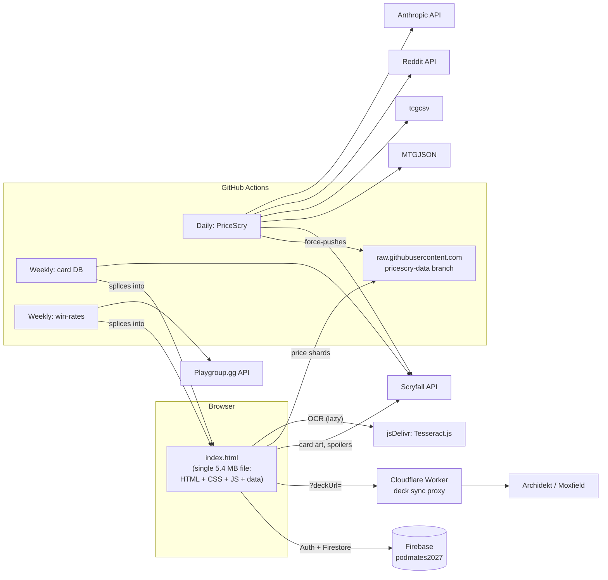

# PodMates — What it is and what it does

> Snapshot of the project as of **2026-11-08** (commit `e817ad2`). This describes the system *as it is today*,
> including its rough edges. For the proposed changes see [refactor-plan.md](./refactor-plan.md).

## 1. In one paragraph

**PodMates** is a web app for a regular *Magic: The Gathering* **Commander** playgroup ("pod"). Its tagline is
*"Our table · Our tempo · Our stories"*. Players paste or import a decklist and get a detailed **deck profile**
(power, speed, bracket signals, combos, mana analysis…) so the group can match decks fairly and keep game nights
about shared fun. On top of that it has a **social layer**: pods, game-night "Gatherings" with RSVPs and seating,
a shared match log ("Chronicles"), pod-voted "Impact cards", spoiler voting, and trades. A separate, password-gated
tool, **PriceScry**, tracks card prices (shown in yen) and tries to predict price movers from spoilers.

- **Live site:** <https://anf1978.github.io/PodMates/> (GitHub Pages, served from `main`)
- **Audience:** a Japan-based playgroup (prices in ¥, Japanese shops, an in-app hint for using the browser's
  Japanese translation). The UI itself is English-only.
- **Installable:** has a web manifest and icons, but no service worker (so no offline mode).

## 2. Features

### 2.1 Deck Chart (single-deck analysis) — works without an account

**Getting a deck in**

| Input | How it works |
|---|---|
| Paste a list | Free-text parser accepts `1 Sol Ring`, `1x Sol Ring`, Moxfield/Archidekt exports, and a `Commander:` line. |
| Import by link | Archidekt / Moxfield URL → fetched through a **Cloudflare Worker** proxy (CORS workaround). Optional "keep synced". |
| Deck Crafter | In-app deck builder with card search. |
| Scan cards | Photo → OCR via **Tesseract.js** (lazy-loaded from jsDelivr) → card names. |
| Try a Deck | 174 embedded sample decks (6 hand-curated + 168 official precons). |
| Load a Deck | Load from your saved decks or decks your pod shares with you. |

**What you get back** (each is a collapsible panel)

- **Deck Profile radar** on five axes — *Speed, Consistency, Versatility, Disruption, Power Level* — each with a
  percentile and tier placement against a **224-deck reference corpus** (precon / tuned / cEDH).
- **Key Pieces & Combos** — from a hand-curated combo list plus an offline **Commander Spellbook** snapshot.
- **Mana Curve** — expected mana available per turn.
- **Win Condition & Table Vibe** — win-con detection, archetype match, "how this will feel at the table".
- **Official Bracket Signals** — WotC Commander Brackets checks (Game Changers, two-card infinites, etc.).
- **Card Type Frequency & Curve**, **Mana Base: Cost vs. Production**, **Synergy Profile**.
- **Commander Track Record** — real win-rate data from Playgroup.gg.
- **Commander Centrality** — how much the deck depends on its commander.
- **Structure & Legality** — deck size, banned cards, colour identity.
- Extras: visual **View Deck** gallery (card art from Scryfall), **Export** for Archidekt/Moxfield, **Save** (with a
  "secret from my pod" toggle).

### 2.2 MyPods (social) — needs a real account

- **Pods:** create/join, invite links, leader controls, multiple pods per person, pod & player profiles.
- **The Full Ledger:** sortable table of every deck saved by you and shared by your pod.
- **Pod Comparison:** chart up to 6 decks side by side.
- **Gatherings:** host a game night, invite, RSVP, seats (incl. guest seats), table formations, "go live", end.
- **Chronicles & Stories:** shared match history per pod — results, notes, lessons, feedback.
- **Impact Cards:** a default list of high-impact cards; pods can nominate/propose changes. Pod edits only affect a
  separate "Pod view" line — never the main scores.
- **Spoiler Bait:** swipe-vote ("bang" / "bin") on freshly spoiled cards; pod board aggregates votes.
- **Trades:** per-user trade list.
- **Notifications:** in-app activity inbox merged from your pods' feeds (no email/push).

### 2.3 Accounts & profile

- Every visitor is **signed in anonymously** on load, so charting works instantly.
- Optional sign-up: email/password, Google, Yahoo. Signing up **links** the anonymous identity, so nothing is lost.
- **My Profile:** link Archidekt/Moxfield decks (kept in sync), profile links, **My Data** backup/restore of saved decks.

### 2.4 PriceScry (password-gated)

Card price history and speculation tooling, tabs: *Search, Movers, Signals, Radar, Ledger, Bait*. Prices from
Scryfall, MTGJSON (TCGplayer, Cardmarket, Card Kingdom, Manapool) and tcgcsv, converted to yen. A daily pipeline also
watches spoilers/leaks (Reddit API; leak images read by Claude via the Anthropic API) and keeps an honest
"shadow prediction" scoreboard. The password is a **client-side soft gate** — the code says so itself — and the data
lives on a public branch.

### 2.5 Cosmetics

Colour themes (Classic, plus MTG colour-pair and tri-colour themes) applied via CSS variables before first paint.

## 3. Architecture (as-is)

### 3.1 System context



There is **no build step**. `index.html` *is* the app; deploying = committing it to `main`.

### 3.2 Anatomy of `index.html`

| Block (`<script id>` / tag) | Lines | Size | Purpose |
|---|---:|---:|---|
| `<style>` + `#pm-visual-overhaul` | ~1,260 | ~51 KB | All CSS ("Terraria × MTG Arena" theme + overrides) |
| `#theme-script` | 152 | 11 KB | Colour themes, runs in `<head>` |
| `<body>` markup | ~310 | 45 KB | Static shell: auth bar, header, mode tabs, deck form, result panels |
| `#engine-script` | 2,921 | 288 KB | **Deck Compass** classification & scoring engine (+ curated combos, win-rate data). DOM-free. |
| `#lookup-script` | 198 | 7 KB | Decklist parsing & card lookup indexes. DOM-free. |
| `#data-script` | — | 2.8 MB | `CARD_DB_COMPRESSED_B64` — gzip+base64 Scryfall oracle DB |
| `#combo-data-script` | — | 0.5 MB | `SPELLBOOK_SNAPSHOT_B64` — Commander Spellbook snapshot |
| `#app-script` | 28,906 | 1.5 MB | Everything else: UI, features, Pods, PriceScry, … **~16.8k of these lines are the embedded Try-a-Deck library.** |
| `#notif-script` | 153 | 12 KB | Notifications inbox (IIFE) |
| `<script type="module">` | 1,363 | 74 KB | Firebase SDK (from gstatic CDN) + `window.PodmatesCloud` bridge (~90 functions) |

Rough split of the 5.4 MB: **~3.8 MB embedded data on a handful of very long lines**, ~0.34 MB Try-a-Deck lists,
~0.05 MB CSS, ~1.2 MB JS logic + HTML templates (~477 top-level functions, all in the global scope).

### 3.3 Embedded datasets

| Constant | Source | Refreshed by |
|---|---|---|
| `CARD_DB_COMPRESSED_B64` | Scryfall oracle bulk data | `rebuild-card-database.yml` (weekly) |
| `IX_TAGS_JSON` | Scryfall Tagger function tags | same workflow |
| `COMMANDER_TIER_DATA` | Playgroup.gg win-rates | `rebuild-winrate-database.yml` (weekly) |
| `SPELLBOOK_SNAPSHOT_B64` | Commander Spellbook export | manual (`spellbook-snapshot-probe.yml` → hand-paste) |
| `KNOW_JSON` (~300 KB) | ranked community card lists | `know-build.cjs` — **not in repo** |
| `IMPACT_CANDS` | derived from lists + precons | `impact-cands.cjs` — **not in repo** |
| `REFERENCE_SCORES`, `REFERENCE_TIERS`, `PRECON_FINGERPRINTS`, `STAPLES_BASELINE`, `MANABASE_BASELINE` | engine run over the reference corpus | scripts **not in repo** |
| `HARD_COMBOS`, `SOFT_SYNERGIES`, `DEFAULT_IMPACT_CARDS`, `GAME_CHANGER_REASONS`, `TRY_A_DECK_OPTIONS` | hand-curated | edited by hand |

The refactor's regression baseline lives in `tests/golden/`: a DOM-free Node VM harness snapshots the full
analysis and five axis scores for all **178 currently embedded decks** (four more than the historical 174 above).
Its card and Spellbook subsets are committed, so weekly data updates cannot move the expected results.
`npm run golden:fixture` deliberately regenerates them and verifies parity against the full embedded databases;
`npm run golden` checks snapshots and also runs through `npm run check`. No floats are rounded.

### 3.4 Boot sequence

1. `#theme-script` applies the saved theme (no colour flash).
2. Inline header script shows a staged progress bar + 30 s watchdog for the card DB.
3. Engine, lookup and data scripts parse; the app decompresses the card DB with `DecompressionStream` and builds
   lookup indexes on the main thread, then sets `window.__dbReady`.
4. The Firebase module runs last (modules are deferred), signs in anonymously, exposes `window.PodmatesCloud`, and
   dispatches a `podmates-cloud-init` event that the app and notifications script wait for.

Scripts talk to each other through **globals** (`window.PodmatesCloud`, `window.pmNotif`, `window.PM_LIMITS`,
`window.__dbReady`, plus every top-level function/const) and **custom DOM events**.

### 3.5 Data model (Firestore)

```text
users/{uid}
  decks/{deckId}            saved decks (deck id = encoded "Commander (Player)" or custom name)
  linkedDecks/{platform-id} Archidekt/Moxfield links (mirrored into decks/ so pods can see them)
  spoilerVotes/{card}       Spoiler Bait votes (readable by podmates)
  trades/{id}
pods/{podId}
  members/{uid}
  gatherings/{gatheringId}  game nights: seats, RSVPs, live state
  chronicles/{entryId}      match log + notes + feedback
  tableFormations/{name}
  activity/{autoId}         notification feed
  impactNominations/{id}
  settings/impactCards      pod's diff against the default impact list
```

Browser storage: `localStorage` (`podmates-theme`, `pm_ja_hint`, `pm_notif_prefs_*`, `pm_notif_seen_*`,
`pm-sb-rarities`, `podmates_last_signin`) and `sessionStorage` (`pricescryUnlocked`). These hold only small
preferences. **Saved decks are cloud-only:** they are stored in Firestore (`users/{uid}/decks`), never in the browser,
so saving needs a real (non-anonymous) account, decks are available on any device you sign in on, and there is no
offline copy. The only local copy is one the user downloads via *My Data* backup.

### 3.6 Data pipelines (`.github/workflows` + `.github/scripts`)

| Workflow | Trigger | What it does | Output |
|---|---|---|---|
| `rebuild-card-database.yml` | Mon 06:00 UTC + manual | Scryfall oracle bulk → `build-card-db.mjs`; tags → `fetch-function-tags.mjs` | **Rewrites `index.html` on `main`** via `splice-card-db.mjs` |
| `rebuild-winrate-database.yml` | Mon 07:00 UTC + manual | Scans Playgroup.gg per-commander API | **Rewrites `index.html` on `main`** via `splice-winrate-db.mjs` |
| `pricescry-daily.yml` | Daily 06:30 UTC | Snapshot prices, FX, MTGJSON, tcgcsv, movers, spoiler radar, shadow predictions, cheap-pick watch | Force-pushes `pricescry-data` branch (512 gzip shards + reports) |
| `pricescry-backfill.yml` | manual, run-once | 90 days of MTGJSON history | `pricescry-data` |
| `pricescry-backtest.yml`, `pricescry-bulkjump.yml` | manual | Research backtests | Workflow artifacts |
| `spellbook-snapshot-probe.yml` | manual | Builds Spellbook snapshot | Artifact (pasted in by hand) |
| `scryfall-tags.yml` | manual | Tag dump (script inlined in YAML) | Artifact |
| `pricescry-probe.yml`, `pricescry-tcgcsv-probe.yml` | manual | One-off investigation of data sources | Logs/artifact |

Secrets used: `GITHUB_TOKEN`, `REDDIT_CLIENT_ID`, `REDDIT_CLIENT_SECRET`, `ANTHROPIC_API_KEY`.

### 3.7 Things the app depends on that are *not* in this repo

- **Firestore security rules** (`firestore.rules`, referenced in comments) — the real security boundary.
- **Cloudflare Worker source** (`worker.js`) for deck sync (`spring-unit-49d9.anthony-ef7.workers.dev`).
- Build scripts `know-build.cjs`, `impact-cands.cjs`, and whatever produced the reference corpus/baselines.
- Firebase console configuration (auth providers, indexes) and the Cloudflare account.

## 4. How it is developed today

- 226 commits since 2026-09-07. **125 are "Add files via upload"** and most of the rest are GitHub web-editor
  Update/Create/Delete commits; 20 are bot data refreshes. In practice: edit with an AI chat → download the whole
  `index.html` → upload it through the GitHub website.
- No `package.json`, tests, linter, type checking, README, or PR process. CI exists only for data refreshes.

## 5. Health check — what we found

Ordered roughly by impact.

1. **Manual uploads are silently reverting the bot's data refreshes (live bug).** The weekly card-DB/win-rate
   commits on 2026-10-26 and 2026-11-02 were both overwritten by manual uploads within days (e.g. bot commits
   `269d81e`/`09b0687` → upload `4b7c389` restored the older data). The site is serving a stale card database and
   win-rates. There is also an earlier `EMERGENCY: restore card database` commit, so this has bitten before.
2. **Everything is one 5.4 MB file.** Any one-line fix forces every user to re-download ~5 MB; the card DB is
   decompressed and indexed on the main thread (a 30 s watchdog exists because phones struggle). An AI assistant
   cannot read or safely edit a file this size in one go, which encourages whole-file regeneration.
3. **Repository bloat:** ~117 MB packed after two months, because every edit stores a new 5 MB file.
4. **Stray files:** `.github/scripts/index.html` (a stale 5.3 MB copy) and `.github/workflows/pricescry-probe.mjs`
   (duplicate of the one in `scripts/`).
5. **No safety net:** no tests, lint, or types, yet the scoring engine is intricate and calibrated against a reference
   corpus. Self-tests exist only for some PriceScry scripts.
6. **Global scope everywhere:** ~477 top-level functions share one namespace across scripts; cross-script contracts
   are implicit.
7. **Hand-synced duplicate code:** PriceScry helpers are copied between `pricescry-lib.mjs` and `index.html`
   ("KEEP IN SYNC"); the Scryfall bulk-download step is copy-pasted across three workflows; `scryfall-tags.yml`
   inlines a second copy of the tag fetcher.
8. **UI code style:** ~1,100 inline `style="…"` attributes and ~170 `innerHTML` usages. An `escapeHtml` helper exists,
   but with pod-shared, user-typed content (deck names, chronicle notes) every write needs to be checked.
9. **Infra not in version control:** Firestore rules and the Worker (see §3.7), so the security model can't be
   reviewed or tested from the repo.
10. **Text encoding damage:** mojibake such as `—` and `¥` in comments (a UTF-8 round-trip issue).
11. **Runtime versions:** workflows pin Node 20, which reached end-of-life in April 2026.
12. **Retired code paths** (e.g. the "POD ROSTERS — retired" section) remain in the file.

**What's genuinely good** and worth preserving: a thoughtful, well-commented domain engine; DOM-free engine and parser
blocks (easy to test); a calibrated reference corpus that doubles as a regression suite; polite, well-documented data
pipelines; graceful degradation (every optional pipeline step is `continue-on-error`); and clear, friendly UX copy.
