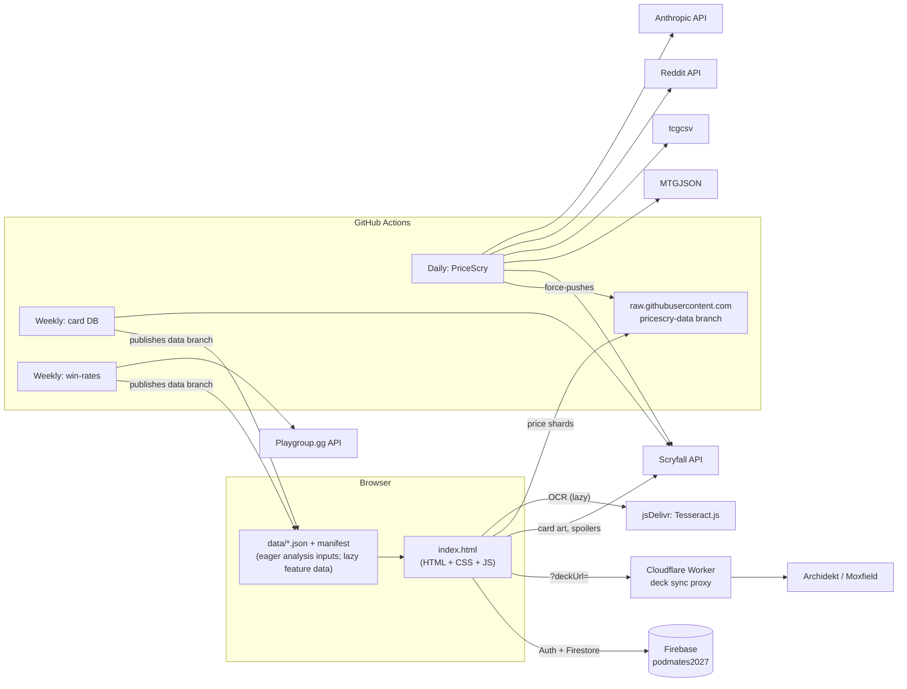

# PodMates — What it is and what it does

> Snapshot of the project as of **2026-11-08** (commit `e817ad2`). This describes the system _as it is today_,
> including its rough edges. For the proposed changes see [refactor-plan.md](./refactor-plan.md).

## 1. In one paragraph

**PodMates** is a web app for a regular _Magic: The Gathering_ **Commander** playgroup ("pod"). Its tagline is
_"Our table · Our tempo · Our stories"_. Players paste or import a decklist and get a detailed **deck profile**
(power, speed, bracket signals, combos, mana analysis…) so the group can match decks fairly and keep game nights
about shared fun. On top of that it has a **social layer**: pods, game-night "Gatherings" with RSVPs and seating,
a shared match log ("Chronicles"), pod-voted "Impact cards", spoiler voting, and trades. A separate, password-gated
tool, **PriceScry**, tracks card prices (shown in yen) and tries to predict price movers from spoilers.

- **Live site:** <https://anf1978.github.io/PodMates/> (GitHub Pages, served from `main`)
- **Audience:** a Japan-based playgroup (prices in ¥, Japanese shops, an in-app hint for using the browser's
  Japanese translation). The UI itself is English-only.
- **Installable:** has a web manifest and icons, but no service worker (so no offline mode).

## 2. Features

### 2.1 Deck Chart (single-deck analysis) — works without an account

**Getting a deck in**

| Input          | How it works                                                                                                        |
| -------------- | ------------------------------------------------------------------------------------------------------------------- |
| Paste a list   | Free-text parser accepts `1 Sol Ring`, `1x Sol Ring`, Moxfield/Archidekt exports, and a `Commander:` line.          |
| Import by link | Archidekt / Moxfield URL → fetched through a **Cloudflare Worker** proxy (CORS workaround). Optional "keep synced". |
| Deck Crafter   | In-app deck builder with card search.                                                                               |
| Scan cards     | Photo → OCR via **Tesseract.js** (lazy-loaded from jsDelivr) → card names.                                          |
| Try a Deck     | 178 sample decks, fetched from the extracted deck library.                                                          |
| Load a Deck    | Load from your saved decks or decks your pod shares with you.                                                       |

**What you get back** (each is a collapsible panel)

- **Deck Profile radar** on five axes — _Speed, Consistency, Versatility, Disruption, Power Level_ — each with a
  percentile and tier placement against a **224-deck reference corpus** (precon / tuned / cEDH).
- **Key Pieces & Combos** — from a hand-curated combo list plus an offline **Commander Spellbook** snapshot.
- **Mana Curve** — expected mana available per turn.
- **Win Condition & Table Vibe** — win-con detection, archetype match, "how this will feel at the table".
- **Official Bracket Signals** — WotC Commander Brackets checks (Game Changers, two-card infinites, etc.).
- **Card Type Frequency & Curve**, **Mana Base: Cost vs. Production**, **Synergy Profile**.
- **Commander Track Record** — real win-rate data from Playgroup.gg.
- **Commander Centrality** — how much the deck depends on its commander.
- **Structure & Legality** — deck size, banned cards, colour identity.
- Extras: visual **View Deck** gallery (card art from Scryfall), **Export** for Archidekt/Moxfield, **Save** (with a
  "secret from my pod" toggle).

### 2.2 MyPods (social) — needs a real account

- **Pods:** create/join, invite links, leader controls, multiple pods per person, pod & player profiles.
- **The Full Ledger:** sortable table of every deck saved by you and shared by your pod.
- **Pod Comparison:** chart up to 6 decks side by side.
- **Gatherings:** host a game night, invite, RSVP, seats (incl. guest seats), table formations, "go live", end.
- **Chronicles & Stories:** shared match history per pod — results, notes, lessons, feedback.
- **Impact Cards:** a default list of high-impact cards; pods can nominate/propose changes. Pod edits only affect a
  separate "Pod view" line — never the main scores.
- **Spoiler Bait:** swipe-vote ("bang" / "bin") on freshly spoiled cards; pod board aggregates votes.
- **Trades:** per-user trade list.
- **Notifications:** in-app activity inbox merged from your pods' feeds (no email/push).

### 2.3 Accounts & profile

- Every visitor is **signed in anonymously** on load, so charting works instantly.
- Optional sign-up: email/password, Google, Yahoo. Signing up **links** the anonymous identity, so nothing is lost.
- **My Profile:** link Archidekt/Moxfield decks (kept in sync), profile links, **My Data** backup/restore of saved decks.

### 2.4 PriceScry (password-gated)

Card price history and speculation tooling, tabs: _Search, Movers, Signals, Radar, Ledger, Bait_. Prices from
Scryfall, MTGJSON (TCGplayer, Cardmarket, Card Kingdom, Manapool) and tcgcsv, converted to yen. A daily pipeline also
watches spoilers/leaks (Reddit API; leak images read by Claude via the Anthropic API) and keeps an honest
"shadow prediction" scoreboard. The password is a **client-side soft gate** — the code says so itself — and the data
lives on a public branch.

### 2.5 Cosmetics

Colour themes (Classic, plus MTG colour-pair and tri-colour themes) applied via CSS variables before first paint.

## 3. Architecture (as-is)

### 3.1 System context



Vite bundles `src/main.ts` and copies `public/`; `index.html` is static markup and CSS. See [deploy.md](./deploy.md) for the GitHub Pages Actions deployment.

### 3.2 Anatomy of `index.html`

| Block (`<script id>` / tag)       |  Lines |   Size | Purpose                                                                                                        |
| --------------------------------- | -----: | -----: | -------------------------------------------------------------------------------------------------------------- |
| `<style>` + `#pm-visual-overhaul` | ~1,260 | ~51 KB | All CSS ("Terraria × MTG Arena" theme + overrides)                                                             |
| `#theme-script`                   |      1 |  <1 KB | Placeholder for `src/features/themes/prepaint.ts`, inlined as a classic script at build time; runs in `<head>` |
| `<body>` markup                   |   ~310 |  45 KB | Static shell: auth bar, header, mode tabs, deck form, result panels                                            |
| `<script type="module">`          |      1 |  <1 KB | `src/main.ts`: boots the card data, then wires every feature through `src/app/`                                |

The HTML is now about 1,300 lines of markup and CSS, down from 5.53 MB; every script is a typed module in `src/`
and all large datasets are external JSON.

### 3.3 Datasets

The three bot-managed constants now load from `cards.json`, `tags.json` and `winrates.json` through
`loadDataset()` before DB-ready, retaining their original global names and encodings. Committed snapshots
under `public/data/` are the local-dev/CI fallback; deploy overlays the validated `data` branch publication.
Never edit generated data by hand. `scripts/extract-bot-datasets.mjs` reproduces this cutover from older HTML.

`data/manifest.json` describes every file with `version`, `generatedAt`, SHA-256, byte length and source.
The loader revalidates it before fetching hash-versioned URLs. The footer displays card/win-rate dates and
quietly warns when cards are over 14 days old. Extraction timestamps describe the committed fallback snapshot;
weekly publications use refresh time, preserving dates of datasets that were not refreshed.

Try-a-Deck decklists are fetched only on library/sample-table use or card-search ranking. First chart and
pod-detail requests load fingerprints plus derived deck metadata (without ordinary decklists); announced
decks retain a validation list so unavailable cards are filtered exactly as before. Knowledge data/indexes
load when "Cards you could add" opens, and Impact candidates when the Impact modal opens. Their existing
loading UI remains visible while waiting; dismissing a loading modal cannot reopen it on completion.
Cards, win-rates, reference percentiles, staples/manabase baselines and Spellbook stay eager because every
complete analysis/scoring view needs them. Function tags stay eager for the first chart's Key Interactions,
not just the optional suggestions. No engine score inputs or golden outputs change.
The other datasets listed below
(except the small code-like tables) are now `public/data/<CONSTANT>.json`, extracted without changing their
runtime values by `scripts/extract-static-datasets.mjs`. Spellbook retains its original gzip/base64 encoding.

| Constant                                                                                              | Source                                       | Refreshed by                                                    |
| ----------------------------------------------------------------------------------------------------- | -------------------------------------------- | --------------------------------------------------------------- |
| `CARD_DB_COMPRESSED_B64`                                                                              | Scryfall oracle bulk data                    | `rebuild-card-database.yml` (weekly)                            |
| `IX_TAGS_JSON`                                                                                        | Scryfall Tagger function tags                | same workflow                                                   |
| `COMMANDER_TIER_DATA`                                                                                 | Playgroup.gg win-rates                       | `rebuild-winrate-database.yml` (weekly)                         |
| `SPELLBOOK_SNAPSHOT_B64`                                                                              | Commander Spellbook export                   | manual (`spellbook-snapshot-probe.yml` → extracted JSON string) |
| `KNOW_JSON` (~300 KB)                                                                                 | ranked community card lists                  | `know-build.cjs` — **not in repo**                              |
| `IMPACT_CANDS`                                                                                        | derived from lists + precons                 | `impact-cands.cjs` — **not in repo**                            |
| `REFERENCE_SCORES`, `REFERENCE_TIERS`, `PRECON_FINGERPRINTS`                                         | engine run over the reference corpus         | scripts **not in repo**                                         |
| `STAPLES_BASELINE`, `MANABASE_BASELINE`                                                               | engine run over 174 sample decks             | `pipelines/reference-corpus/benchmark-baselines.mjs` (manual)   |
| `TRY_A_DECK_OPTIONS`                                                                                  | hand-curated decklists                       | extracted JSON                                                  |
| `HARD_COMBOS`, `SOFT_SYNERGIES`, `DEFAULT_IMPACT_CARDS`, `GAME_CHANGER_REASONS`                       | hand-curated code-like tables (still inline) | edited by hand                                                  |

The refactor's regression baseline lives in `tests/golden/`: a DOM-free Node VM harness snapshots the full
analysis and five axis scores for all **178 sample decks** (four more than the historical 174 above).
Its card and Spellbook subsets and win-rates are pinned in `tests/golden/fixtures/`, so weekly data updates
cannot move the expected results. `npm run golden:fixture` deliberately regenerates the cards/Spellbook
and verifies parity against the extracted datasets;
`npm run golden` checks snapshots and also runs through `npm run check`. No floats are rounded.

### 3.4 Boot sequence

1. `#theme-script` (inlined `src/features/themes/prepaint.ts`) applies the saved theme and text size (no colour flash).
2. `src/main.ts` runs after parsing. `app/page.ts` starts `services/boot-status.ts` (real dataset/worker progress;
   its 30 s watchdog measures progress stalls, not total boot duration) and `services/card-data.ts`, which awaits
   the typed `loadDataset()` loader's cached JSON fetches and keeps the results (no globals). Early Try-a-Deck/Impact clicks wait
   for these required datasets; failures appear in the existing boot error UI.
3. In parallel with the required static datasets, `src/cards/db.worker.ts` fetches `data/cards.json`, decodes its
   gzip/base64 string with `DecompressionStream`, parses the card records and builds all three name indexes.
   One structured-clone message carries the records and plain index-entry arrays, preserving shared card identity;
   the main thread only hydrates `Map`s. There are no transferable buffers in the final string/object graph.
   Missing Worker support (or missing decompression in the worker) uses the shared main-thread decoder/indexer.
   If `DecompressionStream` is also missing on the main thread, the legacy compatibility error still applies;
   this step does not introduce a gzip polyfill. Worker errors/stalls terminate it and reach the boot error UI.
   The extracted Spellbook string is fetched and decoded in its existing optional fallback path. Only then is
   the card data marked ready and Chart Deck enabled. Golden tests import the same DOM-free codec without starting a worker.
4. The `src/app/` wiring modules mount every feature; the cloud repositories start Firebase signed out (there
   is no automatic anonymous sign-in) the first time a feature imports them.

Modules talk to each other through imports, explicit ports supplied by `src/app/`, and the typed event bus
(`src/services/events.ts`). Nothing is published on `window`.

### 3.5 Data model (Firestore)

```text
users/{uid}
  decks/{deckId}            saved decks (deck id = encoded "Commander (Player)" or custom name)
  linkedDecks/{platform-id} Archidekt/Moxfield links (mirrored into decks/ so pods can see them)
  spoilerVotes/{card}       Spoiler Bait votes (readable by podmates)
  trades/{id}
pods/{podId}
  members/{uid}
  gatherings/{gatheringId}  game nights: seats, RSVPs, live state
  chronicles/{entryId}      match log + notes + feedback
  tableFormations/{name}
  activity/{autoId}         notification feed
  impactNominations/{id}
  settings/impactCards      pod's diff against the default impact list
```

Security rules are versioned at `firebase/firestore.rules` with emulator tests. The deployed
console configuration and real index export still need human verification.

Browser storage: `localStorage` (`podmates-theme`, `pm_ja_hint`, `pm_notif_prefs_*`, `pm_notif_seen_*`,
`pm-sb-rarities`, `podmates_last_signin`) and `sessionStorage` (`pricescryUnlocked`). These hold only small
preferences. **Saved decks are cloud-only:** they are stored in Firestore (`users/{uid}/decks`), never in the browser,
so saving needs a real (non-anonymous) account, decks are available on any device you sign in on, and there is no
offline copy. The only local copy is one the user downloads via _My Data_ backup.

### 3.6 Data pipelines (`.github/workflows` + `pipelines/`)

| Workflow                                            | Trigger                | What it does                                                                                      | Output                                                           |
| --------------------------------------------------- | ---------------------- | ------------------------------------------------------------------------------------------------- | ---------------------------------------------------------------- |
| `rebuild-card-database.yml`                         | Mon 06:00 UTC + manual | Scryfall oracle bulk → `build-card-db.mjs`; tags → `fetch-function-tags.mjs`                      | `cards.json` + `tags.json` on force-updated `data` branch        |
| `rebuild-winrate-database.yml`                      | Mon 07:00 UTC + manual | Scans Playgroup.gg per-commander API                                                              | `winrates.json` on the same `data` branch                        |
| `pricescry-daily.yml`                               | Daily 06:30 UTC        | Snapshot prices, FX, MTGJSON, tcgcsv, movers, spoiler radar, shadow predictions, cheap-pick watch | Force-pushes `pricescry-data` branch (512 gzip shards + reports) |
| `pricescry-backfill.yml`                            | manual, run-once       | 90 days of MTGJSON history                                                                        | `pricescry-data`                                                 |
| `pricescry-backtest.yml`, `pricescry-bulkjump.yml`  | manual                 | Research backtests                                                                                | Workflow artifacts                                               |
| `spellbook-snapshot-probe.yml`                      | manual                 | Builds Spellbook snapshot                                                                         | Artifact (pasted in by hand)                                     |
| `scryfall-tags.yml`                                 | manual                 | Tag dump (script inlined in YAML)                                                                 | Artifact                                                         |
| `pricescry-probe.yml`, `pricescry-tcgcsv-probe.yml` | manual                 | One-off investigation of data sources                                                             | Logs/artifact                                                    |

Secrets used: `GITHUB_TOKEN`, `REDDIT_CLIENT_ID`, `REDDIT_CLIENT_SECRET`, `ANTHROPIC_API_KEY`.

The weekly publishers validate counts/shapes before writing a SHA-256 manifest, preserve the other workflow's
datasets and force-update an orphan data commit with an explicit lease. A shared concurrency group prevents
lost updates. A failed tag fetch logs a warning and keeps the previous validated lists; malformed fetched tags
abort publication. Rebuilds never commit to application source. Non-main dispatches publish only to
`data-<source-branch>` for safe validation.

Successful main rebuilds trigger `deploy.yml` through `workflow_run` (token pushes do not trigger `push`).
Deployment pins the data branch SHA, checks hashes and copies the files into `dist/data/`; its
`build-manifest.json` and job summary record that revision and every hash. If no data branch exists yet,
the committed snapshots are validated and used explicitly. Existing but invalid publications fail the build.

### 3.7 Things the app depends on that are _not_ in this repo

- **Cloudflare Worker source** (`worker.js`) for deck sync (`spring-unit-49d9.anthony-ef7.workers.dev`).
- Build scripts `know-build.cjs`, `impact-cands.cjs`, and whatever produced the reference corpus/baselines.
- Firebase console configuration (auth providers, indexes) and the Cloudflare account.

## 4. How it is developed today

- 226 commits since 2026-09-07. **125 are "Add files via upload"** and most of the rest are GitHub web-editor
  Update/Create/Delete commits; 20 are bot data refreshes. In practice: edit with an AI chat → download the whole
  `index.html` → upload it through the GitHub website.
- No `package.json`, tests, linter, type checking, README, or PR process. CI exists only for data refreshes.

## 5. Health check — what we found

Ordered roughly by impact.

1. **Manual uploads are silently reverting the bot's data refreshes (live bug).** The weekly card-DB/win-rate
   commits on 2026-10-26 and 2026-11-02 were both overwritten by manual uploads within days (e.g. bot commits
   `269d81e`/`09b0687` → upload `4b7c389` restored the older data). The site is serving a stale card database and
   win-rates. There is also an earlier `EMERGENCY: restore card database` commit, so this has bitten before.
2. **Everything is one 5.4 MB file.** Any one-line fix forces every user to re-download ~5 MB; the card DB is
   decompressed and indexed on the main thread (a 30 s watchdog exists because phones struggle). An AI assistant
   cannot read or safely edit a file this size in one go, which encourages whole-file regeneration.
3. **Repository bloat:** ~117 MB packed after two months, because every edit stores a new 5 MB file.
4. **Stray files:** `.github/scripts/index.html` (a stale 5.3 MB copy) and `.github/workflows/pricescry-probe.mjs`
   (duplicate of the one in `scripts/`).
5. **No safety net:** no tests, lint, or types, yet the scoring engine is intricate and calibrated against a reference
   corpus. Self-tests exist only for some PriceScry scripts.
6. **Global scope everywhere:** ~477 top-level functions share one namespace across scripts; cross-script contracts
   are implicit.
7. **Hand-synced duplicate code:** PriceScry helpers are copied between `pricescry-lib.mjs` and `index.html`
   ("KEEP IN SYNC"); the Scryfall bulk-download step is copy-pasted across three workflows; `scryfall-tags.yml`
   inlines a second copy of the tag fetcher.
8. **UI code style:** ~1,100 inline `style="…"` attributes and ~170 `innerHTML` usages. An `escapeHtml` helper exists,
   but with pod-shared, user-typed content (deck names, chronicle notes) every write needs to be checked.
9. **Infra not in version control:** Firestore rules and the Worker (see §3.7), so the security model can't be
   reviewed or tested from the repo.
10. **Text encoding damage:** mojibake such as `—` and `¥` in comments (a UTF-8 round-trip issue).
11. **Runtime versions:** workflows pin Node 20, which reached end-of-life in April 2026.
12. **Retired code paths** (e.g. the "POD ROSTERS — retired" section) remain in the file.

**What's genuinely good** and worth preserving: a thoughtful, well-commented domain engine; DOM-free engine and parser
blocks (easy to test); a calibrated reference corpus that doubles as a regression suite; polite, well-documented data
pipelines; graceful degradation (every optional pipeline step is `continue-on-error`); and clear, friendly UX copy.
