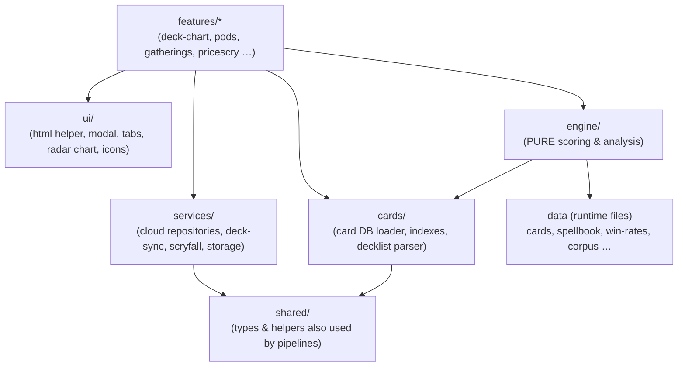
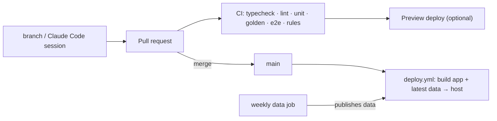

# PodMates — Refactor plan

> **Status:** Draft for review · **Date:** 2026-11-08 · **Context:** [overview.md](./overview.md) (read §5 "Health
> check" first — this plan is the response to it).

## 1. Goals and non-goals

**Goals**

1. **Never break the live site.** Incremental, behaviour-preserving steps; every step is shippable on its own.
2. **Good engineering standards:** modules, types, tests, lint, CI, reproducible builds and data, infra-as-code.
3. **Well-architected:** clear layers with one-way dependencies, data separated from code, a pure scoring engine.
4. **Optimised for AI-assisted ("vibe") coding with Claude:** small focused files, strong types, one-command
   verification, and a `CLAUDE.md` that gives the agent the map, the rules, and the guardrails.

**Non-goals (for this refactor)**

- No visual redesign and no feature changes. Users should not notice anything except faster loads.
- No Firestore schema changes — existing user data must keep working untouched.
- Not leaving Firebase, and not a framework rewrite (see decision D2).

## 2. Why this shape (the vibe-coding angle)

Today an AI assistant has to work on a 5.4 MB, 35k-line file it cannot read in full. The natural result is
"regenerate the whole file and upload it", which is exactly how the weekly data refreshes keep getting reverted
(overview §5.1). Claude does its best work when:

- the code it needs fits in context → **files under ~400 lines, one concern each**;
- it can tell what a function accepts and returns without reading callers → **TypeScript types**;
- it can prove a change works on its own → **`npm run check` (types + lint + tests) in under a minute**;
- the rules of the house are written down where it will see them → **`CLAUDE.md`, plus nested ones per area**;
- dangerous areas are fenced off → **generated files marked, protected by CI and hooks**.

Everything below serves those five points as much as it serves classic engineering hygiene.

## 3. Guiding principles

1. **Strangler, not rewrite.** Move code out of `index.html` piece by piece; old and new coexist until the old is empty.
2. **Data is not code.** Datasets live in data files, loaded at runtime. Bots never touch source files.
3. **The engine is pure.** No DOM, no network, no globals — input a decklist + card DB, output a result object.
4. **One way to do each thing.** One Firestore gateway, one rendering/escaping helper, one modal system, one
   storage wrapper.
5. **Generated ≠ hand-written.** Generated files are clearly marked and never edited by hand.
6. **Everything needed to rebuild lives in the repo** — Firestore rules, the Worker, every data-build script.
7. **Golden tests before moves.** Pin the current behaviour first, then refactor against it.

## 4. Target architecture

### 4.1 Stack (recommended)

| Concern | Choice | Why |
|---|---|---|
| Build/dev server | **Vite** | Zero-config, fast, outputs static files for any host. |
| Language | **TypeScript** (strict), migrating with `allowJs` | Biggest single win for AI correctness; catches cross-module breakage. |
| Rendering | **Vanilla DOM + [lit-html](https://lit.dev/docs/libraries/standalone-templates/)** tagged templates | Existing code already builds UI with template strings + `innerHTML`; lit-html is a near-mechanical swap that **auto-escapes** and updates efficiently. No framework rewrite. (Decision D2.) |
| Firebase | Modular SDK **from npm** (same v12 line) | Types, tree-shaking, version pinned in `package.json`. |
| Unit tests | **Vitest** | Same config as Vite, fast, great with TS. |
| E2E tests | **Playwright** (+ axe for accessibility) | Smoke-test real flows in a real browser. |
| Lint/format | **ESLint** (typescript-eslint, `no-unsanitized`) + **Prettier** | Enforced in CI and by Claude hooks. |
| Rules tests | **Firebase emulator** + `@firebase/rules-unit-testing` | Security rules become testable code. |
| Node | **22 LTS** everywhere (local + Actions) | Node 20 is end-of-life. |

### 4.2 Layers



Rules (enforced by lint, e.g. `eslint-plugin-boundaries` or `dependency-cruiser`):
`engine` and `cards` import nothing from `ui`, `services` or `features`; features never import each other directly
(they communicate via `services` or a tiny typed event bus); only `services/cloud` imports Firebase.

### 4.3 Directory layout

```text
PodMates/
├─ CLAUDE.md                 # contributor + AI guide (source of truth)
├─ AGENTS.md                 # short pointer to CLAUDE.md for other agents (Copilot, etc.)
├─ README.md
├─ index.html                # thin shell: static markup + <script type="module" src="/src/main.ts">
├─ package.json  tsconfig.json  vite.config.ts  eslint.config.js  .prettierrc  .editorconfig  .gitattributes
├─ public/                   # icons, manifest (copied verbatim)
├─ src/
│  ├─ main.ts                # boot: theme → card DB (worker) → cloud → UI
│  ├─ engine/                # PURE. analyze.ts, axes/, brackets.ts, combos.ts, mana.ts, centrality.ts, archetype.ts
│  │  ├─ CLAUDE.md           # engine rules: purity, golden tests, calibration notes
│  │  └─ __golden__/         # pinned outputs for the 174 sample decks
│  ├─ cards/                 # CardTuple types, db.worker.ts (decompress + index off main thread), lookup.ts, parse-decklist.ts
│  ├─ data/                  # hand-curated typed data: combos.ts, impact-defaults.ts, game-changers.ts, try-a-deck/
│  ├─ services/
│  │  ├─ cloud/              # firebase.ts + one repository per collection: decks.ts, pods.ts, gatherings.ts …
│  │  ├─ deck-sync.ts  scryfall.ts  storage.ts
│  ├─ ui/                    # html.ts (lit-html re-export + helpers), modal.ts, tooltip.ts, tabs.ts, radar-chart.ts, icons/
│  ├─ features/
│  │  ├─ deck-chart/ (panels/*)  deck-crafter/  try-a-deck/  scan-cards/  export/
│  │  ├─ auth/  profile/  pods/  gatherings/  chronicles/  impact/  spoiler-bait/  trades/
│  │  ├─ notifications/  ledger/  comparison/  themes/
│  │  └─ pricescry/          # lazy-loaded chunk, own CLAUDE.md
│  ├─ shared/                # code imported by BOTH app and pipelines (e.g. PriceScry name-key/shard hashing)
│  └─ styles/                # tokens.css (existing CSS variables), base.css, one CSS file per feature
├─ pipelines/                # Node data builders (moved from .github/scripts), each with tests + README
│  ├─ CLAUDE.md
│  ├─ lib/  card-db/  winrates/  spellbook/  knowledge/  reference-corpus/  pricescry/
├─ firebase/                 # firestore.rules, firestore.indexes.json, firebase.json, rules.test.ts
├─ workers/deck-sync/        # Cloudflare Worker source + wrangler.toml + tests
├─ tests/e2e/                # Playwright specs
├─ docs/                     # overview, architecture, data-model, glossary, pipelines, adr/
└─ .github/
   ├─ workflows/             # ci.yml, deploy.yml, data-weekly.yml, pricescry-*.yml
   └─ actions/scryfall-bulk/ # composite action replacing 3 copy-pasted download steps
```

### 4.4 Data: out of the HTML, off the main thread

| Today | Target |
|---|---|
| 3.8 MB of base64/JSON inside `index.html` | Separate files: `cards.json`, `spellbook.json`, `winrates.json`, `tags.json`, `knowledge.json`, `corpus.json`, `try-a-deck.json` |
| Everything parsed on every load | Card DB + spellbook at boot; Try-a-Deck, knowledge, fingerprints **lazy-loaded** when the feature opens |
| Decompress + index on the main thread (30 s watchdog) | Done in a **Web Worker**; UI stays responsive, real progress reporting |
| Any code fix re-downloads 5 MB | Content-hashed filenames + service worker cache → code fixes download only changed JS |
| Bot rewrites `index.html` on `main` | Bot publishes data only (see D5); **bots never edit source** |

A small `data/manifest.json` lists each dataset's version/date/hash so the app (and a status panel) can show "card
data as of …" — which would have made the stale-data bug visible immediately.

### 4.5 Cloud boundary

`window.PodmatesCloud` (~90 untyped functions) becomes typed repositories under `services/cloud/` that mirror the
**existing** document paths and field names exactly (no migration). The Firestore rules move into `firebase/` with
emulator tests, so the client and the rules are reviewed and versioned together. The Worker source moves into
`workers/deck-sync/` with its own deploy workflow.

### 4.6 Delivery



**Revised (ADR 0001):** after the refactor, sessions push straight to `main` with no PR and no preview. Deploy runs
only after CI passes on the pushed commit, so a broken push never reaches the live site. No branch protection that
blocks pushes, and no web uploads.

## 5. Setting the repo up for Claude

### 5.1 Files

| File | Purpose |
|---|---|
| `CLAUDE.md` (root) | The map + house rules. Short (aim < 150 lines) because it is loaded every session. Draft in [Appendix A](#appendix-a--draft-claudemd). |
| `src/engine/CLAUDE.md`, `src/features/pricescry/CLAUDE.md`, `pipelines/CLAUDE.md`, `firebase/CLAUDE.md` | Area-specific rules, loaded only when Claude works in that folder. |
| `AGENTS.md` and `.github/copilot-instructions.md` | One-line pointers to `CLAUDE.md`, so Claude and Copilot follow the same rules. |
| `.claude/settings.json` | Allow-list safe commands (`npm run *`, `git status/diff`); deny edits to generated data; **hooks**: format + lint the edited file after each edit, run `npm run check` before finishing. |
| `.claude/commands/` | Reusable slash commands, e.g. `/check`, `/new-feature <name>` (scaffold folder + test + CSS), `/engine-change` (requires golden-test diff + a written justification). |
| `docs/glossary.md` | Domain terms (Pod, Gathering, Chronicle, Bracket, Game Changer, Impact card, Spark, Centrality, precon, cEDH…) so the agent uses them consistently. |
| `docs/adr/` | Short Architecture Decision Records for D1–D7 below, so future sessions don't relitigate them. |

### 5.2 Conventions that help the agent

- One feature per folder: `index.ts` (public API), `view.ts`, `state.ts`, `*.css`, `*.test.ts`.
- Soft limit ~400 lines per file (data files excluded); lint warns above it.
- Every module starts with a 2–3 line header comment: what it does, what it must not do.
- Public functions have explicit TypeScript types; no `any` without a comment.
- Generated files carry a `// GENERATED by pipelines/… — do not edit` header and live in clearly named folders.

### 5.3 The workflow change (most important — decision D1)

The current workflow is **Claude chat in the iPhone app → download the whole `index.html` → upload it on GitHub**.

Move to **Claude Code in the cloud** — the *Code* section of the same Claude iOS app (also at claude.ai/code),
included with the Pro plan ([docs](https://code.claude.com/docs/en/web-quickstart)). It connects to the GitHub repo,
clones it into a cloud sandbox, edits only the lines it needs, can run `npm run check`, and pushes a branch + opens a
PR. Review and merge happen in the GitHub iOS app. **No computer is needed**, so this fits the friend's phone-only
setup. It reads `CLAUDE.md` from the repo automatically.

This single change removes the root cause of the data-revert bug and repository bloat. Small caveat for the plan: Pro
has usage limits, so prefer small, focused sessions (one feature or fix per PR) — which is the right habit anyway.

## 6. Phased roadmap

Sizes are rough, assuming part-time work with AI assistance. Each phase ends in a working, deployed site. The phases
are broken into one-PR session prompts in [docs/prompts/](./prompts/00-README.md).

### Phase 0 — Stabilise (≈1–2 days, no restructuring)

| # | Task |
|---|---|
| 0.1 | **Fix the stale data now:** re-run both weekly workflows. Until Phase 2 lands, agree on "always start from the latest `main`" before any upload. |
| 0.2 | Delete stray `.github/scripts/index.html` and `.github/workflows/pricescry-probe.mjs`. |
| 0.3 | Bring missing pieces into the repo: `firestore.rules` (+ indexes), Worker source, `know-build.cjs`, `impact-cands.cjs`, reference-corpus scripts. How to retrieve each: [Appendix B](#appendix-b--recovering-the-pieces-not-in-the-repo). |
| 0.4 | Add `README.md`, `.gitattributes` (LF, binary for `*.png`/`*.gz`), `.editorconfig`; repair mojibake. |
| 0.5 | Add an **interim `CLAUDE.md`** for the single-file reality: never regenerate the whole file, never touch the data lines, edit surgically, where things are (line map). Makes vibe coding safer immediately. |
| 0.6 | Bump workflows to Node 22. |

**Exit:** live site has current data; all sources of truth are in the repo.

### Phase 1 — Tooling & safety net (≈2–4 days)

| # | Task |
|---|---|
| 1.1 | `package.json`, Vite serving the **unchanged** `index.html`; Prettier/ESLint configured (lint warn-only for legacy code). |
| 1.2 | **Golden harness for the engine:** the engine and lookup blocks are DOM-free, so a test can extract them from `index.html`, run them in a Node `vm` with the decoded card DB, and snapshot `analyzeDeck` + all five axis scores for the 174 embedded sample decks. Uses a pinned card-DB fixture (only the cards those decks need) so weekly data refreshes don't move the goalposts. |
| 1.3 | Playwright smoke test: page loads, DB ready, "Try a Deck" → chart → radar and panels render, no console errors. |
| 1.4 | `ci.yml` on every PR: lint, golden, e2e. `deploy.yml` builds and deploys via Actions (Pages "GitHub Actions" source). |
| 1.5 | Friend moves to Claude Code (iOS app, cloud sessions) pushing to `main` (D1, revised: no PRs, no branch protection that blocks pushes; deploy gated on CI in p6-1). |

**Exit:** `npm run check` is green and is the definition of "done" for every change.

### Phase 2 — Separate data from code (≈3–5 days)

| # | Task |
|---|---|
| 2.1 | Move each embedded dataset into its own file (§4.4), loaded via a typed `loadDataset()` with progress. |
| 2.2 | Card DB decompress + indexing moves into a Web Worker. |
| 2.3 | Lazy-load Try-a-Deck lists, knowledge lists, fingerprints. |
| 2.4 | Pipelines write data files (per D5) instead of splicing HTML; delete `splice-*.mjs`. |
| 2.5 | Add "data as of" to `data/manifest.json` and show it in the UI footer. |

**Exit:** `index.html` + JS under ~1.3 MB; bots no longer touch source; golden + e2e still green. *(Needs a short
coordinated code freeze — see Risks.)*

### Phase 3 — Modularise (strangler, ≈3–5 weeks part-time)

Move code into `src/` in this order, converting to TypeScript as each piece moves. After each step the golden and e2e
tests must pass unchanged.

1. **Engine + cards + parser** → `src/engine`, `src/cards` (pure, fully typed, unit-tested). Golden tests now import
   the modules directly instead of the `vm` harness.
2. **Cloud** → `src/services/cloud/*` typed repositories; keep a temporary `window.PodmatesCloud` shim for legacy code.
3. **UI primitives** → `src/ui`: one modal/overlay system (replacing `tad-overlay`, `ps-overlay`, `showInfoModal`,
   `showConfirmModal`, …), `html` helper, tooltip, tabs, status, radar chart.
4. **Features**, one PR each: deck-chart panels → try-a-deck/export/scan → deck-crafter → auth/profile → pods →
   gatherings → chronicles → impact → spoiler-bait → trades → notifications → ledger/comparison → themes → pricescry.
   Inline `style="…"` moves into per-feature CSS using the existing CSS variables.
5. **Remove shims and globals**; turn the lint rules from warn to error.

**Exit:** no source file over ~500 lines; no globals; all Firestore access through `services/cloud`; every
`innerHTML` replaced by escaped templates.

### Phase 4 — Harden (≈1–2 weeks)

- Firestore rules tests in CI (emulator), covering pod membership, secret decks, and size limits (`PM_LIMITS`).
- Security pass on rendering (lint bans raw `innerHTML`); review Worker input validation.
- Service worker (`vite-plugin-pwa`) for caching/offline; performance budget in CI (bundle size).
- Accessibility pass (axe in Playwright), error reporting (at minimum a central `reportError()`).
- PriceScry access decision (D3/D7): accept "soft gate" explicitly, or move to a real Firebase-auth gate.

### Phase 5 — Pipelines tidy (≈1 week, can run in parallel with Phase 3)

- `.github/scripts` → `pipelines/` with shared `lib/`; port the PriceScry self-tests to Vitest; fixture tests for the
  card-DB builder (it previously failed silently on gzip input).
- `src/shared/` holds code used by both app and pipelines — ends the "KEEP IN SYNC" copy between
  `pricescry-lib.mjs` and the page.
- Composite action for the Scryfall bulk download; archive one-off probe workflows; pin action versions.
- Optional: shrink repo history (`git filter-repo`) once nobody has old clones in use (D6).

## 7. Testing strategy

| Layer | What | Tool | When |
|---|---|---|---|
| Golden | Full engine output for 174 sample decks | Vitest snapshots | Phase 1 → forever |
| Unit | Parser formats, mana/bracket/combo rules, PriceScry helpers, repositories (mocked) | Vitest | Phase 3 |
| Rules | Who can read/write what in Firestore | Firebase emulator | Phase 4 |
| E2E | Load → chart; sign-in; pod create/join; gathering flow | Playwright (+ emulator) | Phase 1 smoke, grows in 3–4 |
| Pipelines | Builders on small fixtures; existing self-tests | Vitest | Phase 5 |

Engine changes that *intentionally* move scores must update the golden snapshots in the same PR with a written reason
(enforced by the `/engine-change` command and PR template). The 224-row `REFERENCE_SCORES` table then gets
regenerated by the corpus script brought in at 0.3.

## 8. Risks and mitigations

| Risk | Mitigation |
|---|---|
| Scores drift during the move | Golden tests on all 174 decks before any code moves. |
| Breaking existing users' saved data | No schema changes; repositories mirror current paths/fields; emulator tests; keep the same Firebase project and SDK major version. |
| Feature work continues in parallel and collides with the split | Phases 0–1 don't move code. For the Phase 2 cut-over, a short (1–2 day) coordinated freeze; after that, small PRs merged continuously. |
| Friend doesn't adopt the new workflow | It's the same Claude app on the same phone and plan, just the *Code* tab; pair on the first session; Phase 0 interim `CLAUDE.md` helps even with the old workflow. |
| Deploy switch causes downtime | Test `deploy.yml` on a fork/preview first; switching the Pages source is reversible in seconds. |
| GitHub Pages can't set cache headers | Service worker handles caching; or choose Firebase Hosting / Cloudflare Pages (D4). |

## 9. Decisions for review

Recommended option in **bold**.

| # | Decision | Options |
|---|---|---|
| D1 | Development workflow | **Decided: Claude Code cloud sessions from the iOS app, pushing to `main`; deploy gated on CI** · PRs reviewed in the GitHub app (original recommendation) · keep chat + web upload (blocks most of this plan) |
| D2 | UI approach | **Vanilla + lit-html templates** · Preact/React rewrite (better AI fluency, much bigger rewrite) · Svelte |
| D3 | PriceScry's place | **Same repo, own lazy-loaded feature + own pipelines folder** · separate repo/app |
| D4 | Hosting | **Stay on GitHub Pages (deploy via Actions) + service worker** · Firebase Hosting (headers, PR preview channels — already on Firebase) · Cloudflare Pages |
| D5 | Where generated data lives | **Force-pushed `data` branch (like `pricescry-data`) assembled at deploy** · committed on `main` via bot PRs (simple, repo grows ~3 MB/week) · fetched fresh at deploy time (not reproducible) |
| D6 | Rewrite git history to drop the 117 MB of old copies | **Later, optional** · now · never |
| D7 | TypeScript strictness | **Strict for moved code, `allowJs` for legacy until Phase 3 ends** · JSDoc-only |

**Other questions for your friend:** Can we get the Firebase console and Cloudflare access (or exports of the rules
and Worker)? Where do `know-build.cjs`, `impact-cands.cjs` and the corpus scripts live? Any upcoming features we
should sequence around? Is a Japanese UI wanted later (would favour adding i18n plumbing during Phase 3)?

## 10. What "done" looks like

| Metric | Today | Target |
|---|---|---|
| First-visit download | ~5.4 MB (single file) | < 1.5 MB JS/CSS + data, data cached across code deploys |
| Repeat visit after a code fix | ~5.4 MB | only the changed JS chunks |
| Largest hand-written source file | 35,338 lines | < 500 lines |
| Automated tests | 0 (app) | golden + unit + e2e + rules, all in CI |
| Bots editing source | weekly | never |
| Infra in repo | partial | rules, Worker, all data builders |
| Contributor guide | none | `CLAUDE.md` + docs + ADRs |

---

## Appendix A — Draft `CLAUDE.md`

The target-state version, written once Phase 3 is under way. (Phase 0 ships a shorter interim version for the
single-file app.)

````markdown
# PodMates

Commander (MTG) playgroup companion: deck analysis + pod social features + PriceScry price tool.
Static web app (Vite + TypeScript) on GitHub Pages; Firebase Auth/Firestore; data built by GitHub Actions.
Full context: docs/overview.md · Architecture: docs/architecture.md · Terms: docs/glossary.md

## Commands
- `npm run dev`      local dev server (uses Firebase emulator if `.env.local` says so)
- `npm run check`    typecheck + lint + unit + golden tests. MUST pass before you say you're done.
- `npm run e2e`      Playwright smoke tests
- `npm run golden:update`  ONLY when an engine change is intended; explain the diff in the PR

## Map
- `src/engine/`   pure scoring/analysis. No DOM, network, or globals. See src/engine/CLAUDE.md
- `src/cards/`    card DB loader (web worker), lookup, decklist parser
- `src/services/cloud/`  the ONLY place that talks to Firestore (one file per collection)
- `src/ui/`       shared primitives: html templates, modal, tabs, radar chart
- `src/features/<name>/`  one folder per feature: index.ts, view.ts, state.ts, <name>.css, *.test.ts
- `pipelines/`    Node data builders run by Actions. See pipelines/CLAUDE.md
- `firebase/`     Firestore rules + tests. Rule changes need a rules test.

## Rules
- Never edit generated files (`// GENERATED` header, `public/data/**`). Change the pipeline instead.
- Render with the `html` tagged template from `src/ui/html.ts`. Never assign `innerHTML` with interpolated data.
- No new globals or `window.*`. Import what you need.
- Do not change Firestore paths or field names — real user data depends on them.
- Features don't import other features; go through services or the event bus.
- Keep files under ~400 lines; split by responsibility, not by line count.
- Styles: use CSS variables from `src/styles/tokens.css`; no inline `style=` except dynamic values.
- Small PRs. One feature or fix per PR. Update docs/ if behaviour or architecture changes.

## Gotchas
- Card tuples are positional arrays — use the accessors in `src/cards/tuple.ts`, never raw indexes.
- Pod "Impact card" edits only affect the separate "Pod view" line, never the main scores.
- The PriceScry password is a soft gate, not security.
- Scryfall/Playgroup/tcgcsv have rate limits and asked for identified, polite traffic — keep the User-Agents and delays.
````

---

## Appendix B — Recovering the pieces not in the repo

Nothing is "deployed somewhere secret" — these pieces were pasted straight into web consoles, or written and run
inside Claude chats, and never committed. (Evidence: `pricescry-fx.mjs` notes it was written in a "development
sandbox [that] cannot reach the internet" — that's Claude's chat code-execution sandbox.)

| Piece | Where it lives | How to get it (all doable on a phone browser, easier on a computer) |
|---|---|---|
| Firestore security rules | Firebase project `podmates2027` | console.firebase.google.com → project → **Firestore Database → Rules** tab → copy all → save as `firebase/firestore.rules`. The **Indexes** tab lists composite indexes. With the Firebase CLI: `firebase init firestore` offers to download the current rules and indexes. |
| Cloudflare Worker (deck sync) | Cloudflare account that owns `spring-unit-49d9.anthony-ef7.workers.dev` | dash.cloudflare.com → **Workers & Pages** → `spring-unit-49d9` → **Edit code** → copy → save as `workers/deck-sync/worker.js`. Also note any env vars/secrets under **Settings → Variables** (names only, never values). |
| `know-build.cjs`, `impact-cands.cjs`, corpus/baseline scripts | Most likely in the friend's **Claude chat history** (chat sandbox files don't persist, but the code is in the messages) | In the Claude app, search chats for `know-build`, `impact-cands`, `REFERENCE_SCORES`, `PRECON_FINGERPRINTS`. Open the chat and ask Claude: *"Output the final full version of know-build.cjs."* Also check any Claude **Projects** for uploaded files. If lost, they can be reconstructed from the data shapes (as was already done for `build-card-db.mjs`). |
| Firebase console settings | Firebase project | Auth providers enabled (Anonymous, Email, Google, Yahoo), authorised domains — screenshot or list in `docs/`. |

**Getting your own access (recommended):**

- **GitHub:** repo **Settings → Collaborators → Add people** (needed for you to open PRs, set branch protection, run Actions).
- **Firebase:** console → ⚙ **Project settings → Users and permissions → Add member**, role *Editor* (or *Viewer* to start).
- **Cloudflare:** **Manage Account → Members → Invite**, scoped to Workers.

Never paste secret values (API keys for Reddit/Anthropic, Cloudflare tokens) into the repo or a chat — record only
their names. The Firebase web `apiKey` already in `index.html` is fine to be public; protection comes from the rules.
